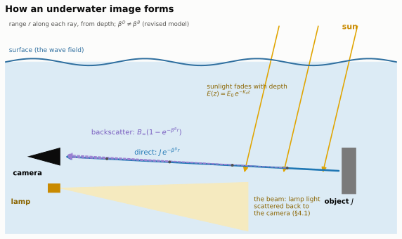
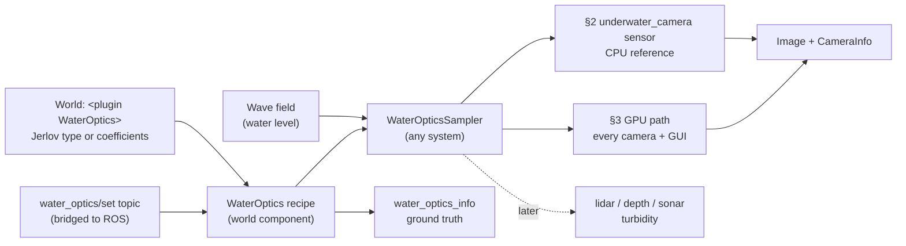
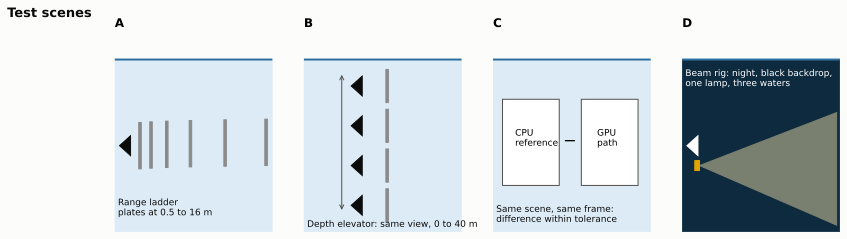
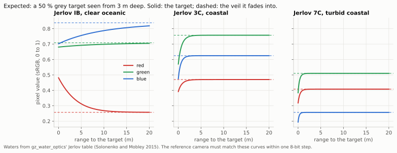
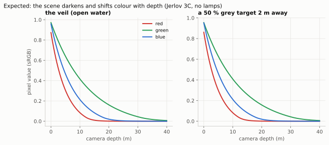
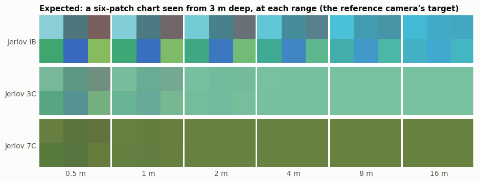
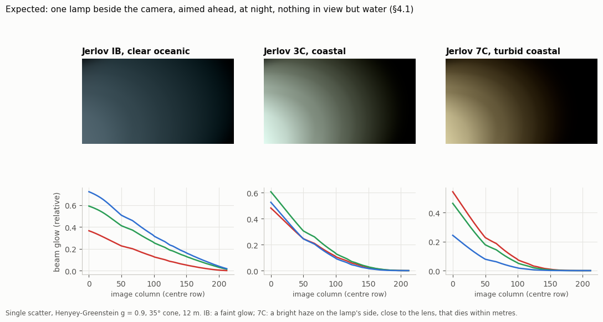
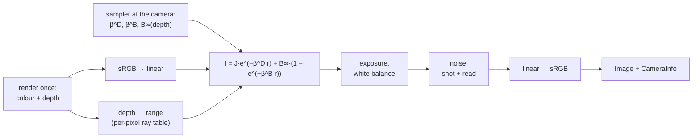

# Underwater camera plan

## Scope and success

A camera under water does not see what a camera in air sees. The water
between the lens and an object dims the object's light, red first, then
green; it adds a veil of its own colour that grows with range; and the
sunlight that lights the object has already faded on its way down. Lights
on the vehicle, forward scatter, marine snow, caustics and the port in
front of the lens come on top. Gazebo renders none of it: an ogre2 camera
under water sees as if in air.



What matters most is the architecture, the way the waves, the wind and the
current have it. The **water's optics belong to the world**, as a recipe any
system can read, settable while running, so every camera in a world sees the
same water and a lidar or a sonar can later read it too. **The model is
written once** and run in two places: a per-sensor camera, which is the
measurable reference, and a GPU path that every camera and the GUI share and
that must match it.



What success looks like:

- A world says "coastal water, Jerlov 3C" (or gives its coefficients), and a
  BlueROV2 camera at 10 m sees a seabed 2 m away clearly, one 8 m away as a
  blue-green shape, and nothing past the veil, in the colours the model
  predicts for that water.
- **Every step is verified three ways**: automated tests in CI, figures of
  the results the model predicts (generated by
  `docs/_tools/underwater_camera_figures.py` from the same equations), and
  a short video of the step working, recorded in the test scenes below.
- **Every step is documented in the same PR** (see
  [Documentation along the way](#documentation-along-the-way)): a feature
  is not done until a user can find it, set it up and check it from the
  docs alone.
- The vehicle's lights fit without a redesign, and come straight after.

## Decisions

- **Perception data first, the GUI second.** Data quality cannot be added
  later; looks can. The per-sensor camera (§2) comes first, and is the
  reference the GPU path (§3) must match.
- **Vehicle lights are not in the first version, but designed for from day
  one** (§4.1). They are the biggest gap in every open-source Gazebo option
  and the hardest part. The GPU path is chosen so its shader can see the
  lights.
- **No gz-rendering changes to start.** If the GPU path needs one (§3), it is
  proposed upstream and vendored meanwhile, as `gz_buoyancy` is.
- **POSIM: techniques only, no code.** We learn from how it does things (§7);
  we write our own implementation.
- **No GPL code.** Stonefish (GPL-3) is a source of ideas only. Jerlov
  presets come from the published optical properties (§1), not from its
  data file.

## Background: what other projects do

The reference image formation model is the revised model of Akkaynak and
Treibitz (CVPR 2018; Sea-thru, CVPR 2019), per colour channel c, at range r
along the ray:

```
I_c = J_c · exp(−β^D_c · r)  +  B∞_c · (1 − exp(−β^B_c · r))
```

J is the object's colour as lit, B∞ the colour of the water far away (the
veil), β^D the attenuation of the object's light and β^B that of the veil.
The older "fog" model uses one coefficient for both and is visibly wrong at
range. Jerlov water types (oceanic I–III, coastal 1C–9C) give the
coefficients from one setting (Solonenko and Mobley, Applied Optics 2015).

| Project | How | What it models | Notes |
|---|---|---|---|
| POSIM (gz-sim 10 + ogre2) | A piece injected into Ogre's PBS material shader: every surface is shaded under water as it is drawn | Attenuation and veil (one coefficient), sunlight fading with depth, caustics on the seabed, marine snow | Coefficients hardcoded; surface flat at z = 0; one global setting; PBS materials only; no lights, blur, noise or port; not validated |
| DAVE gz, uuv_simulator | CPU, on an RGBD camera's image and depth | The fog model | On 8-bit sRGB; RGB and depth can be a frame apart; slow |
| OceanSim (Isaac Sim) | GPU kernel on RGB and depth | The revised model, β^D ≠ β^B | Validated on a real colour chart: 8–14° RGB angular error, better than HoloOcean and UNav-Sim |
| Stonefish (own OpenGL, GPL-3) | In-scene shaders | Jerlov table, sun in-scattering with a phase function, ray-marched light beams, depth-aware blur, marine snow | The most complete real-time model; ideas only |
| HoloOcean, MARUS | Engine fog | Fog | Not physical; HoloOcean worst in OceanSim's colour test |
| Gazebo upstream | Nothing | — | Render passes (noise, distortion, lens flare) see only the colour image, never depth |

That last row decides where a model can run in gz-sim 10:

| | Where | For | Against |
|---|---|---|---|
| A. In the material shading | Every fragment, as drawn | Free; every camera and the GUI; true range per pixel; sees the lights | Global to the scene; PBS materials only (our water surface shader and markers are not); one Hlms listener per process |
| B. A compositor pass with depth | Per camera, after drawing | Per sensor; whole image | A render pass gets no depth today: a gz-rendering change or a workaround |
| C. Colour and depth, then the CPU | Per sensor | Works today; exact tests | GPU to CPU readback; slower at high resolution; cannot see the lights |

## Verification kit

Every step below is checked against the same four scenes and against
figures computed from the model. The figures are regenerated by:

```bash
python3 docs/_tools/underwater_camera_figures.py
```

The waters in them are **illustrative** (clear, coastal, turbid) until PR 1
brings the Jerlov table; the script then reads the table, and the figures
become the exact expected results for each preset.

### Test scenes



| Scene | What it is | Used by |
|---|---|---|
| **A. Range ladder** | A camera 3 m deep facing grey (50 %) and six-patch colour plates at 0.5, 1, 2, 4, 8 and 16 m, each in its own column of the image | §1, §2, §3, §4.2 |
| **B. Depth elevator** | The same camera and a plate 2 m away, lowered together from 0 to 40 m | §1, §2, §3 |
| **C. CPU vs GPU** | Scene A rendered by the reference camera and the GPU path in the same frame | §3 |
| **D. Beam rig** | Night (no sun), a black backdrop at 12 m, one spot lamp beside the camera aimed ahead, three waters | §4.1, §4.3 |

Each is a world under `gz_water_optics/test/worlds/` (and
`kai_gazebo/worlds/underwater_*.sdf` for the demos), with a fixed seed, so
a test and a video show the same thing.

### Expected results

**A grey target against range** (scene A): each channel decays from the
target's colour to the veil's, red first. The reference camera must match
these curves within one 8-bit step.



**Against the camera's depth** (scene B): the veil and a lit target darken,
red first, as `exp(−K_d · depth)`.



**A colour chart, by range and water** (scene A): what the camera must
show, patch by patch. A frame of the real output is placed beside this for
review; the test compares the patch means.



**A lamp's beam** (scene D, §4.1): the glow the single-scatter model
predicts, image and centre row. The GPU beam must match its profile.



### Videos

Each PR attaches its video(s) to the PR description: 20–40 s, 1920×1080,
under 10 MB, side by side where a "before" exists, captions naming what to
look at. They are recorded headless from the scenes above with the same
film tooling used for the wave PRs (`gz_water_optics/tools/film/`), so they
can be re-recorded after any change.

## Documentation along the way

The docs grow with the code, in the places a reader already looks, and
each PR carries its own part. Nothing is left for a "docs PR" at the end.

| Where | What it holds | Grows in |
|---|---|---|
| `gz_water_optics/README.md` | What the package is, the plugin block, the parameters (Jerlov types, `<visibility>`, explicit coefficients), the topics, the sampler for other systems, its tests | PR 1 |
| `gz_underwater_camera/README.md` | The sensor block, its parameters, its pipeline diagram, outputs, performance, its tests | PR 2, 3, 4+ |
| `docs/how-to/underwater-camera.md` (new) | Task guide: give a world its water; set visibility; add an underwater camera to a vehicle; see its image in the GUI and in ROS; change the water while running; lights (PR 4); each effect as it lands. Every snippet taken from a real file in the repo, as the other how-tos do | PR 1, 2, 3, 4+ |
| `docs/how-to/sensors.md` | A short "An underwater camera" section pointing to the how-to | PR 2 |
| `docs/reference/launch-and-world.md` | "Water optics parameters" and "Underwater camera parameters" tables (tag, unit, default, meaning); the Jerlov presets table with each type's visibility; `water_optics/set` and `water_optics_info` in the topics table; the demo worlds in the worlds table | PR 1, 2, 4+ |
| `docs/design/index.md` | "Underwater cameras": why the water belongs to the world, the model and its equation, the CPU reference and the GPU path, the spike's decision and why, what was taken from other projects. The figures from `docs/_tools/underwater_camera_figures.py` | PR 1, 2, 3 |
| `docs/how-to/faq.md` | Troubleshooting as it comes up: "the image is black at depth" (no lamps, by design), "everything looks the same colour" (visibility too low), "the GUI and the camera differ" (which path each uses), "the depth camera sees through murky water" (by design, until turbidity) | PR 2, 3, 4 |
| Public headers | Doxygen on the recipe, the sampler and the sensor's public API: units, frames, defaults | PR 1, 2 |
| `AGENTS.md` | A row per new package, as for every other package | PR 1, 2 |
| This plan | The spike's result (§3), and what changed from the plan in each PR | PR 3, each PR |

### How the documentation is verified

| Check | Kind | Pass when |
|---|---|---|
| The docs build | CI | Sphinx builds with no warnings |
| Snippets are real | CI | every XML and shell snippet in the how-to is taken from a file in the repo (the existing figure and snippet tooling), not hand-copied |
| Every parameter is documented | unit | a test lists the plugin's and the sensor's SDF tags and finds each in the reference table |
| Figures are current | CI | `underwater_camera_figures.py` regenerates the committed figures unchanged |
| A reader can follow it | review | someone who did not write the PR follows the how-to from a clean workspace and gets the result shown in the video |

## 1. Water optics the world owns (`gz_water_optics`)

Built like `gz_ocean_current`: a recipe component on the world entity, a
world system that writes it, a `water_optics/set` topic (bridged to ROS),
ground truth on `water_optics_info`, and a sampler any system asks.

```xml
<plugin filename="gz-maritime-water-optics-system"
        name="gz::sim::maritime::WaterOptics">
  <jerlov>3C</jerlov>              <!-- I, IA, IB, II, III, 1C .. 9C -->
  <visibility>5</visibility>       <!-- optional, m: horizontal, black target -->
  <!-- or explicitly, per R G B, 1/m: -->
  <!-- <attenuation>0.45 0.12 0.10</attenuation>   β^D -->
  <!-- <backscatter>0.40 0.10 0.08</backscatter>   β^B -->
  <!-- <veil>0.02 0.18 0.22</veil>                 B∞ at the surface -->
  <!-- <diffuse_attenuation>0.30 0.10 0.12</diffuse_attenuation>  K_d -->
</plugin>
```

- **Presets.** The Jerlov table holds, per type and per R G B (integrated
  over each channel's band), absorption a and scattering b, from which β^D,
  β^B, B∞ and K_d follow. Explicit values override a preset.
- **Visibility.** Scenario authors describe water as "5 m visibility", not
  as attenuation per metre. `<visibility>` (m) sets how far a black target
  can be seen horizontally, through the standard relation
  `visibility ≈ 4.8 / c_green` (Zaneveld and Pegau 2003), c taken in the
  green, the band cameras are most sensitive in. With a Jerlov type, the
  type gives the colour balance (the ratio between channels) and
  `<visibility>` scales its strength: every channel's a and b are scaled by
  `4.8 / (visibility · c_green)`, and so is K_d, so the colour of the water
  is kept and only its murkiness changes. Alone, it scales the default type (oceanic
  II). Explicit coefficients override it.
- **The water level comes from the wave field** when there is one (the
  `WaveCoupling` level, `SurfaceElevation` above the point), not a fixed
  z = 0.
- **Depth-dependent light**: the depth below the local surface, and the
  sunlight and veil scaled by `exp(−K_d · depth)`.

### How it is verified

| Check | Kind | Pass when |
|---|---|---|
| Every preset loads and its a, b match the published table per channel | unit | equal to the table within 1e-6 |
| β^D, β^B, B∞, K_d derived from a, b as the plan's formulas say | unit | equal to a hand-computed value for 3 presets |
| Explicit tags override a preset, tag by tag | unit | only the given tags change |
| `<visibility>` sets the strength: `4.8 / c_green` of the result | unit | equals the given visibility to 1e-6, for 3 types and 1, 5, 20 m |
| `<visibility>` keeps the type's colour balance | unit | the ratios c_red : c_green : c_blue and b : c per channel are unchanged |
| `<visibility>` alone; with explicit coefficients | unit | alone, it scales oceanic II; explicit coefficients win, with a warning |
| `<visibility>` zero, negative or missing | unit | an error naming the tag for zero or negative; missing leaves the type as it is |
| Unknown type, negative or missing values | unit | an error naming the tag; the world keeps clear water |
| `water_optics/set` changes the recipe while running; `water_optics_info` reports it | integration | the sampler returns the new values within one step |
| A world without the system | integration | the sampler reports clear water (no effect) |
| Water level from the waves | integration | on the Gerstner test wave, depth = `SurfaceElevation − z` at 5 points, to 1 mm |
| The sampler at a point: depth, light factor `exp(−K_d·depth)`, veil | unit | equal to the closed form at 0, 5, 20 m |

**Figure to verify against:** `uw-expected-depth.svg`, regenerated from the
real table: the light factor and veil the sampler returns at 0–40 m, plotted
over the figure's curves, must lie on them.

**Video:** none (no image yet). A table and a chart of the 13 presets
(c, b, B∞ per channel) go in the PR instead.

## 2. The reference camera (per sensor, approach C)

A gz-maritime custom sensor, `underwater_camera`, the pattern of the
hydrophone and the anemometer:

```xml
<sensor name="camera" type="custom" gz:type="underwater_camera">
  <update_rate>15</update_rate>
  <camera> ... the usual camera block ... </camera>
  <gz:underwater_camera>
    <exposure>auto</exposure>
    <white_balance>none</white_balance>   <!-- none | grey_world | fixed -->
    <noise>shot_and_read</noise>
  </gz:underwater_camera>
</sensor>
```



- Renders **colour and depth in one pass**, so they never come from
  different frames (DAVE's problem).
- Range per pixel from depth, with a per-pixel ray-length table (z-depth to
  range).
- The model on **linear** colour (sRGB decoded first, encoded after), with
  the water from §1 at the camera's depth.
- Exposure and white balance, then noise (shot and read).
- Publishes `gz.msgs.Image` and `CameraInfo`, bridged to ROS as usual.
- Performance target: 640×480 at 15 Hz on a laptop CPU.

### How it is verified

Each stage of the pipeline above has its own test, so a failure names the
stage.

| Stage | Check | Kind | Pass when |
|---|---|---|---|
| Colour + depth | one render gives both, same stamp | integration | stamps equal on 100 frames |
| Ray table | z-depth to range at the centre, corners, edges | unit | equal to `‖((u−cx)/fx, (v−cy)/fy, 1)‖·z` to 1e-6 |
| Linearisation | sRGB → linear → sRGB round trip | unit | identity on all 256 values |
| The model | a synthetic J and r, per channel | unit | equal to the closed form to 1e-6 |
| The model, β^D ≠ β^B | same, with different coefficients | unit | closed form; and differs from the fog model by the expected amount |
| Scene A | grey plate at each range, patch mean per channel | render | within one 8-bit step of `uw-expected-range.svg`'s curves |
| Scene A | colour plates, patch means | render | within 2 steps of `uw-expected-chart.png`, per patch |
| Scene B | plate and veil at 0, 5, 10, 20, 40 m | render | within one step of `uw-expected-depth.svg` |
| Above water | the camera above the surface | render | output equals the plain camera's, byte for byte |
| Exposure, white balance | grey world on scene A | unit | the mean of a neutral patch is neutral to 1 % |
| Noise | flat input, 1000 frames | unit | mean unchanged, variance as configured to 5 % |
| Depth untouched | a depth camera in the same world | render | byte-identical with the optics on or off |
| Throughput | 640×480 | benchmark | ≥ 15 Hz on the reference laptop; recorded in the PR |

**Figures to verify against:** `uw-expected-range.svg`,
`uw-expected-depth.svg`, `uw-expected-chart.png`. The test also writes a
figure of its own (measured points over the expected curves, the camera's
chart beside the expected chart) to the test log, for review.

**Video:** *"Through the water"*, 30 s.

1. Scene A, side by side: the plain camera (in air) and the underwater
   camera, in clear, coastal and turbid water, 6 s each. Look for: the far
   plates fade into the veil, red first; turbid hides everything past 2 m.
2. Scene B, the camera lowered from 0 to 40 m in coastal water, 10 s, with
   a depth readout. Look for: the scene darkening and turning blue-green.
3. The BlueROV2 over a seabed, switching Jerlov types live through
   `water_optics/set`, 8 s.

## 3. The GPU path (A or B, decided by a spike)

**Spike, about two days, first.** Two questions:

1. Can a render pass on an ogre2 camera reach the camera's depth through
   its compositor workspace, without forking gz-rendering? If yes, B.
2. Can the chosen path see the scene's lights (position, direction, cone,
   colour) per pixel? Lights (§4.1) need it.

The spike's output is a short note in this plan (what was tried, what
worked) and a throwaway prototype that renders scene A.

If B is not possible without a change, A: our own piece in the PBS shader
(written from scratch, using the techniques in §7), with:

- the parameters from §1, not hardcoded;
- the water level from the wave field;
- the existing gz-rendering Hlms listener chained, so its pieces keep
  working;
- the water surface shader (`gz_waves_rendering`) given the same model, so
  the surface seen from below matches;
- per-sensor settings (exposure, noise) still applied per sensor.

A depth input for render passes, or a participating medium, is proposed to
gz-rendering upstream either way. Performance target: 1080p at 30 Hz.

### How it is verified

| Check | Kind | Pass when |
|---|---|---|
| Scene C: GPU against the reference camera, same frame, noise off | render | mean absolute difference ≤ 1 step, 99th percentile ≤ 3 steps, per channel |
| Scene B through the GPU path | render | within one step of `uw-expected-depth.svg` |
| Every material type: PBS, unlit, the water surface shader, markers | render | each one attenuated (no object "in air" under water) |
| Depth untouched | render | depth camera and gpu_lidar byte-identical, optics on or off (POSIM's test) |
| Other gz-rendering features still work: spherical clip, segmentation, thermal | render | their existing tests pass with the optics on |
| The GUI view | manual + screenshot | matches a camera sensor at the same pose (difference image in the PR) |
| Throughput | benchmark | 1080p ≥ 30 Hz; recorded in the PR |

**Figure to verify against:** a difference heat map (GPU − CPU) per
channel, written by the scene C test, in the PR.

**Video:** *"Same water, every camera"*, 25 s. Scene C side by side, CPU
reference and GPU, with the difference image below, in three waters; then
the GUI orbiting the BlueROV2 over the seabed in coastal water.

## 4. What makes it look real

In order of value for ROV work. Each item has its own tests and video.

### 4.1 Vehicle lights, and their beams

At depth, at night or in murky water, the vehicle's own lights (a
BlueROV2's Lumen lights) are the only light.

- Light dims both ways: lamp to object and object to camera,
  `exp(−β^D · (r_light + r_camera))`.
- The beam: light scattered back to the camera by the water inside each
  spot cone, a single-scatter integral along the ray clipped to the cone,
  ray-marched (at half resolution if needed), with a phase function
  (Henyey–Greenstein to start).

| Check | Kind | Pass when |
|---|---|---|
| A lit plate at known lamp and camera ranges | render | its value is `J·E·exp(−β^D(r_l + r_c))/r_l²` within one step |
| Scene D, the beam's centre row | render | matches `uw-expected-beam.png`'s profile, normalised, within 5 % |
| Beam reach | render | clear water carries the beam farther across the view, murky water keeps it nearer the lamp (corrected in phase 4: brightest-near-the-lens is not monotonic in murkiness, see Progress) |
| Lamp outside the view | render | the beam still lights the water in view (scatter, not geometry) |
| Lights off | render | equals §3 output byte for byte |
| Throughput with 2 lamps | benchmark | 1080p ≥ 20 Hz |

**Video:** *"Lights on"*, 30 s. The BlueROV2 at 20 m at night in coastal
water, lamps off then on; the same in clear and turbid water; one lamp
swept across the view.

### 4.2 Forward scatter

A blur whose radius grows with range.

| Check | Kind | Pass when |
|---|---|---|
| A sharp edge (scene A, a black/white plate) at 1, 4, 8 m | render | edge width grows with range as configured, ±10 % |
| At 0 range | render | no blur |

**Video:** the range ladder, blur off and on, side by side.

### 4.3 Marine snow

Particles near the camera, bright only where the lights cross them,
consistent across cameras.

| Check | Kind | Pass when |
|---|---|---|
| Particles are world-fixed | render | two cameras, same particle at the projected position, 1 px |
| Hidden by the scene | render | none drawn behind a plate |
| Lit only by the lamps at night | render | none visible with the lamps off |
| Depth untouched | render | byte-identical |

**Video:** scene D with snow, lamps on and off, and the vehicle moving
through it.

### 4.4 Caustics

On the seabed in shallow water, driven by our wave field.

| Check | Kind | Pass when |
|---|---|---|
| Pattern follows the waves | render | flat water: no caustics; sea state 3: present, moving with the wave period |
| Fades with depth | render | contrast falls as `exp(−K_d · depth)`, ±10 % |

**Video:** a seabed at 3 m, sea state 0 then 3, then the seabed at 15 m.

### 4.5 The surface from below

Snell's window, total internal reflection, in the water surface shader.

| Check | Kind | Pass when |
|---|---|---|
| Window angle | render | the window's edge at 48.6° from vertical (n = 1.333), ±1° |
| Outside the window | render | the surface reflects the water below |

**Video:** looking up from 5 m, flat sea then sea state 3.

### 4.6 The port

A real flat or dome port as an image remap (a flat port is not just
Brown–Conrady distortion).

| Check | Kind | Pass when |
|---|---|---|
| Flat port, a grid at known range | render | the grid's projected corners match the refraction model to 0.5 px |
| Dome port centred on the lens | render | no remap (identity) |

**Video:** a grid plate, in air, flat port, dome port, side by side.

## 5. Validation against reality

- Following OceanSim: RGB angular error on a colour chart against real
  footage, at known ranges in known water. Target: under 10° mean.
- BlueROV2 footage with a chart is the target data set; the scene that
  reproduces it is added to the kit, and its comparison figure (real frame,
  simulated frame, error per patch) goes in the docs.

## 6. Pull requests

| PR | Content | Verified by | Documented in |
|---|---|---|---|
| 1 | Water optics the world owns (§1) | §1 tests; the presets table and chart; `uw-expected-depth.svg` from the real table | `gz_water_optics/README.md`; how-to: "Give a world its water", "Set visibility"; reference: water optics parameters, Jerlov presets, topics; design: "Underwater cameras" (the model, why world-owned); `AGENTS.md` |
| 2 | The reference camera (§2), the BlueROV2 camera switched to it, demo world | §2 tests; *Through the water* video | `gz_underwater_camera/README.md`; how-to: "Add an underwater camera", "See its image"; `sensors.md` section; reference: camera parameters, demo world; design: the pipeline; FAQ; `AGENTS.md` |
| 3 | The GPU path (§3) after the spike, and the GUI | §3 tests; *Same water, every camera* video | design: the spike's decision and why; how-to: "The GUI view"; FAQ: GUI vs camera; the camera README's performance table |
| 4 | Vehicle lights and beams (§4.1) | §4.1 tests; *Lights on* video | how-to: "Lights at depth"; reference: light parameters; FAQ: "black at depth" |
| 5+ | The rest of §4, one at a time | each item's tests and video | each effect: a how-to section, its reference rows, a figure or still |

## 7. Techniques learned from POSIM (no code taken)

- Shading in the material pass gives the true range per pixel for free, and
  affects every camera and the GUI at once.
- Sunlight scaled by `exp(−c · depth)` where the material shader lights a
  surface, not on the finished image, so lit and shadowed parts fade alike.
- The sky drawn from below as the far veil, with a path length to the
  surface along each ray.
- Marine snow on a world-fixed grid walked along each ray, hashed per cell:
  particles stay put across cameras and frames, and are hidden by the scene.
- Byte-identical depth with every effect on or off, as a test: the optics
  must not change what a depth camera or a lidar sees.

What we do differently: water from the world recipe, not hardcoded; the
water level from the waves; per-sensor settings; the revised model (β^D ≠
β^B) on linear colour; validation.

## Progress

### Phase 1, water optics the world owns: done, on `ahcorde/uw_phase1_water_optics`

What it settled, beyond this plan:

- **The Jerlov table** (`gz_water_optics/src/Jerlov.cc`): a, b and K_d of
  all ten types at red 625, green 525, blue 450 nm, from Solonenko and
  Mobley (2015) Tables 4–8, through the Apache-2.0 transcription in
  `tishibashi-cpu/jerlov`, which checks it against the paper's equations.
  Not yet checked against the printed paper by us. 5C at 625 nm uses
  Williamson and Hollins (2022) and Jerlov (1976), the printed row being
  corrupted.
- **From a type**, β^D = β^B = c = a + b at each channel's wavelength; the
  revised model's β^D ≠ β^B is reached through explicit values. B∞ = b / c,
  the single-scattering albedo, as a fraction of the daylight: the veil
  matches a white target lit by the same daylight when b / c = 1.
- **`<visibility>`** scales K_d along with a and b.
- **Ground truth** at 1 Hz by default; any unknown element is warned about.
- **Figures** now read the real table: the IB, 3C and 7C waters, and a new
  `uw-jerlov-presets.svg`.
- **Docs**: `gz_water_optics/README.md`, `docs/how-to/underwater-camera.md`,
  the reference's water optics parameters (with the presets table) and
  topics, a design section, the `AGENTS.md` row; a test checks every element
  and preset is in the reference and the README; Sphinx builds with no
  warnings.

### Phase 2, the reference camera: done, on `ahcorde/uw_phase2_reference_camera`

What it settled, beyond this plan:

- **No new rendering sensor.** Gazebo's `rgbd_camera` already renders
  colour and depth in one pass with one stamp; the camera is a plugin inside
  it (Gazebo loads plugins inside a `<sensor>`), pairing the two by stamp.
  The depth image holds z-depth (checked: a wall 4.95 m away reads 4.95 at
  the centre and the corners), so the ray table converts it to range, using
  the intrinsics of the sensor's own `camera_info`.
- **Parameters** are `<exposure>` (a gain or `auto`), `<max_gain>`,
  `<white_balance>` (`none`, `grey_world`), `<shot_noise>`, `<read_noise>`,
  `<seed>` and `<output_topic>`, rather than one `<noise>` keyword.
- **Per pixel**, the daylight is faded to each object's own depth, and a
  climbing ray counts only the water up to the surface (flat at the camera's
  local surface); a pixel that hits nothing is the veil, or the sky through
  the surface for a climbing ray.
- **Results**: the rendered test finds the published image identical to the
  model computed in the test (19,200 pixels, 0 steps of difference); 640×480
  in 22 ms (45 Hz) on the CPU; above the water byte for byte unchanged.
- **The demo** is `kai_gazebo/worlds/underwater_camera_demo.sdf` (open water,
  a neutral ambient, charts at 0.5–16 m, an image panel per camera), in the
  world tests. **The BlueROV2's own camera is not switched yet**: it lives in
  `bluerobotics_models`, a separate PR there.
- **Video**: *Through the water*, 54 s: three waters side by side with the
  plain camera, a dive from 0.5 to 40 m, the water changed live.

### Phase 3, the GPU path: done, on `ahcorde/uw_phase3_gpu_path`

**The spike's answers.**

1. *Can a render pass reach the camera's depth without forking
   gz-rendering?* **No.** `Ogre2RenderTarget::UpdateRenderPassChain` chains
   passes between two colour textures (`_ogreTextures[2]`); the camera's
   depth buffer is Ogre's pooled one, not a texture the chain exposes.
   Approach B would need gz-rendering internals or a change.
2. *Can the chosen path see the lights?* **Yes, for approach A**: the PBS
   pixel shader is where lights are evaluated; their data is in the pass
   buffer, and more can be appended by the same listener.

So **approach A**: `gz_underwater_rendering`, the model in Ogre's PBS
shaders, chaining gz-rendering's composite pieces (copied at run time with
one more `@insertpiece`) and its Hlms listener.

What it settled:

- **Matches the reference camera**: mean 0.01 of an 8-bit step, 99th
  percentile 1 (criterion 1 and 3), rendered test; depth, a camera above the
  water and segmentation labels byte for byte unchanged; the reference
  camera passes through when the GPU path is on (an `UnderwaterRendering`
  marker component on the world).
- **The GUI uses it**: checked with screenshots on a virtual display.
- **Not done, against the plan**: unlit materials are drawn as in air (only
  PBS is shaded). The sky, the background and the water surface were too,
  until the fixes below. Depth is from
  the still water level, not the waves. No throughput benchmark in CI yet
  (the PBS change costs a few ALU instructions per fragment).
- **Video**: *Same water, every camera*: the reference and the GPU images of
  one scene side by side, with their difference, and the GUI.

### Phase 4, vehicle lights and their beams: done, on `ahcorde/uw_phase4_lights`

In the GPU path (`gz_underwater_rendering`), as the spike said it must be.

- **Lamps** are the world's spot and point lights (up to four). The shader
  lights with them itself, by their diffuse term with Ogre's own spot cone
  and attenuation, faded `exp(−β^D d)` from lamp to fragment, then the
  water to the camera as for any light. To count them once, they are hidden
  from Ogre's lighting while the water is drawn. (Switching Forward+ off by
  property was tried first: Ogre still writes Forward+'s data into the pass
  buffer, so every field after it moved. Hiding the lamps keeps the layout.)
- **Beams**: single scatter along the view ray, Henyey–Greenstein g = 0.9,
  up to 8 attenuation lengths of the clearest channel. Each lamp is marched
  over the piece of the view ray inside its range and its cone (found in
  closed form), in 12 steps spaced quadratically (dense at the near end,
  where the cone enters). That is as close to the fine integral as the
  first version's 32 steps over the whole ray, at a third of the work.
  Uniform steps over the whole ray were 57 % off in coastal water;
  equi-angular and exponential spacings were tried and were worse.
- **`<daylight>`** joins the water optics (default 1, 0 at night): it scales
  the veil, for both the reference camera and the GPU path.
- **gz gives Ogre a light's power as `<intensity>` × π**; the tests use it.
- **Results** (rendered, at night 20 m down): a lamp-lit plate within 1
  step of its clear-water colour faded both ways; the beam within 2 % of a
  single-scatter integration in IB, 3C and 7C.
- **A correction to this plan**: "brighter near the lens the murkier the
  water" does not hold with a lamp 35 cm from the lens: in 7C the lamp's
  light fades before it reaches the view, and 3C glows brightest. What holds,
  and is tested: clear water carries the beam farther; murky water keeps it
  nearer the lamp.
- **Speed**: the beams are the costliest part of the shader. A lamp that
  gives no light (its power times its brightest diffuse channel under 0.01)
  is left out, and with every lamp out the lamp code is not compiled into
  the shaders. At 1920x1080 on an Intel Iris Xe, against 32 steps over the
  whole ray for every lamp: 25.8 ms a frame to 14.8 ms with two lamps off,
  25.9 to 18.2 with two on; on an RTX 4090 Laptop the whole effect is about
  1 ms.
- **Limits**: diffuse only, no shadows; four lamps; the reference camera
  has no lamps. (The beam used to show only where something was drawn
  behind it; the backdrop of the fixes below ended that.)
- **Video**: *Lights on*: lamps off and on at 20 m at night in 1C, 3C and
  7C, and a lamp swept across the view.

### Phase 5, what makes it look real: done, on `ahcorde/uw_phase5a_scatter_and_port` and `ahcorde/uw_phase5b_caustics_snow_snell`

| Effect | Where | Result |
|---|---|---|
| Forward scatter | reference camera, `<forward_scatter>` | edge width at 2, 4, 8 m within 7 % of the Gaussian's (after the 0.8 px of a sharp pixel edge) |
| The port | reference camera, `<port>` | flat: within 0.1 px of Snell's law; dome: no change |
| Caustics | GPU path, water's `<caustics>` | none on flat water; contrast fades with depth as `exp(−K_d z)`, within 6 % (time-averaged) |
| Marine snow | GPU path, water's `<marine_snow>` | fixed frame to frame, lit by the lamps, depth untouched |
| The surface from below | `gz_waves_rendering`'s water shader | Snell's window at 48.5 degrees (48.6 by Snell's law) |

What changed from the plan:

- Forward scatter and the port are in the reference camera only (they need
  the whole image); caustics and snow in the GPU path only (per fragment).
- Caustics are procedural, scaled by the wave height the plugin estimates
  from the wave field, not traced from the surface. A first estimator
  sampled in step with the test wave and swung with its phase; 64 points on
  a golden-angle spiral fixed it.
- Marine snow is tested frame to frame with a still camera, not across two
  cameras; it does not drift.
- The surface from below is drawn in Snell's window. Since the fixes below
  it is seen through the water too.
- **The reference camera.** Its
  loops run on the machine's cores, the sRGB encoding is a lookup that
  gives the formula's own answer, and forward scatter blurs only the
  levels a pixel reads. Same output, byte for byte: 1920x1080 in 24 ms for
  152 (the water alone), 320 for 1042 with forward scatter.
- **Video**: *More of the water*: forward scatter and the port side by
  side, caustics on sand, marine snow in the lamps, Snell's window.

Found later with a demo, a two-minute BlueROV2 dive at Sand Island over the
site's bathymetry, and fixed here:

- **The water's surface shaded the seabed.** With a sun that casts shadows,
  the surface, an opaque mesh to the renderer, put everything under it in
  shadow: a seabed a quarter as bright, and caustics too dim to see. The
  surface casts no shadow now. This also explained caustics missing on a
  bathymetry mesh: the mesh was fine, it was in that shadow.
- **The surface from below was drawn as in air.** `gz_waves_rendering`'s
  water visual now reads the water optics when the renderer draws the
  water, and its shader fades the surface over the range to it and adds the
  veil, with the same model as the PBS pieces. Outside Snell's window the
  mirror is the veil's colour; the sky dims with the daylight.
- **Open water was the sky.** Past the last thing in view an underwater
  camera saw the sky or the background colour. A black box around the
  world, drawn behind everything (depth clamped to the far plane, after the
  sky, no depth written), is the veil through the water. The shader clears
  it for cameras above the water and for gz-rendering's solid-colour
  cameras, which also need their custom parameter set on it before every
  pass (they take it off every renderable after each of theirs).
- **Not reproduced**: Snell's window once drew black in a run with a
  Gerstner sea. Fourteen runs since, with both seas, all drew the sky.
- **What open water costs.** With the
  backdrop, open water is shaded like any surface, so beams and snow are
  paid on every pixel of an underwater view. At a wreck at night with snow
  at 0.35, a 1920x1080 frame on the Intel went from 21.5 ms to 29.4. The
  snow's walk now stops at the first speck the ray touches and lights it
  once (28.2 ms; by day 26.3 to 22.0), and the plugin has a `<quality>`:
  at `low` (8 beam steps, snow to 1.5 m, 2 lamps) that frame is 22.2 ms.
- **A half-resolution pass for beams and snow: not possible from a
  plugin.** It would compute them once per pixel from the depth buffer.
  gz-rendering chains a camera's render passes on its colour image only
  (`Ogre2RenderTarget` connects `rt0` and `rt1`); the depth is not handed
  to an added pass, so this needs a change in gz-rendering first.

### Phase 6, validation against reality: tools done, validation not done, on `ahcorde/uw_phase6_validation`

**No real footage has been compared yet: that is still the open question
below.** What this phase built is everything the comparison needs:

- `make_chart_world.py`: a world reproducing a chart shot (a 24-patch
  ColorChecker at a range and depth, in a Jerlov type or visibility, facing
  the reference camera), and the patches' pixel boxes.
- `chart_validation.py`: OceanSim's metric, the RGB angular error per patch
  in linear light (brightness does not count), with a report and a pass at a
  10 degree mean.
- Tests: the metric's properties; a closed loop on synthetic charts (the
  same water near 0, an exposure change near 0, another water far); the
  command line; the chart world (valid SDF, patches in the image, in order).
- End to end on renders: two renders of the same 3C scene compare at 0.00
  degrees; a 5C render standing in for "real" against the 3C one at 13.4
  (a fail, as it should). That example report is in the docs, labelled as
  not a validation.
- Docs: how to shoot the footage, simulate it, mark the patches and compare.

## Open questions

- Which BlueROV2 camera settings (resolution, field of view, port type) match
  the real vehicle?
- Is there real footage with a colour chart we can validate against?
- Should the optics also degrade the depth camera and lidar (turbidity), and
  when?
