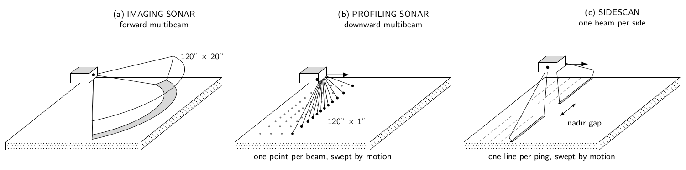
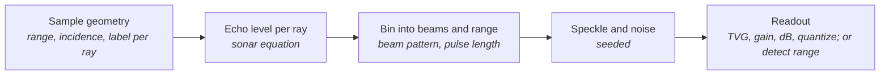

# Sonar simulation design

Status: first draft, 2026-11-20. Numbered decisions and open questions at the end are for discussion.

## Use cases

The sonar simulation exists so that a team can develop underwater perception and mapping in simulation and run the same pipeline on the real vehicle. The driving case is the Virtual RobotX 2027 competition, but the needs are generic to small marine robots working in shallow harbor water:

1. Detect and classify objects underwater, from a strong, simple target (a hollow sphere) up to lookalike shapes, low-contrast objects and clutter near structures, including when the camera cannot see.
2. Measure the range and bearing to a nearby object precisely enough to report its position in the world.
3. Decide whether a space (a dock bay, a route) is clear of submerged obstructions.
4. Survey an area and produce a georeferenced map product of the seabed and an object on it, such as a shipwreck, from a surface vehicle, an underwater vehicle, or both.

The water is shallow: nominally 3 to 12 m, at most 30 m. 

The simulation is used for scored competition runs as well as development, so it must be repeatable from a seed, run on the evaluation hardware alongside several vehicles, and expose difficulty through a small set of documented parameters.


Tree types of sonar, all the same engine, but with different geometry. 


## Sonars in scope

| Sonar | Where | Use cases | Exemplar | Native product of the exemplar |
|---|---|---|---|---|
| Imaging sonar (forward-looking multibeam) | UUV forward slot | 1, 2, 3 | Sonoptix ECHO (defaults): 400 kHz to 100 m or 700 kHz to 30 m, 256 beams over 90° or 120°, 20° vertical, up to 25 Hz. Also, for example, Teledyne BlueView M900-130 Mk2: 900 kHz, 130°, to 100 m | uint8 matrix, one column per beam and one row per range sample |
| Profiling sonar (downward multibeam) | UUV downward slot, or USV | 4 | Cerulean Surveyor 240-16 (defaults): 240 kHz, angle of arrival, 4° along track by 80° across, 10 to 20 soundings per ping, up to 100 m, up to 20 Hz. Also, for example, a beamformed profiler such as the Teledyne Odom MB2: 200 to 460 kHz, 1.8° by 1.8° beams | Soundings: a range and an angle per detection, sometimes with water-column intensity |
| Sidescan | USV, one unit per side | 4 | Cerulean Omniscan 450 SS: 450 kHz, 0.5° along track by 50° vertical, up to 150 m, up to 20 Hz | One line per ping: 200 to 1200 uint16 samples in dB, with range start, length, gain and sound speed |

A UUV has two sonar slots, forward and downward. A USV carries the sidescan, the profiling sonar, or both. 

Out of scope: single-beam echosounders and altimeters, interferometric sidescan, synthetic aperture sonar, sub-bottom profilers, mechanically scanned sonars (imaging or profiling), 3D sonars with a two-dimensional receive array, acoustic positioning (USBL, LBL) and acoustic communication, which is a separate design.

The three sonars differ in where they point and how wide the beam is in elevation, not in the underlying physics. An imaging sonar has a beam wide in elevation: every pixel sums echoes from a tall wedge of water, so the image shows the scene's appearance (highlights, shadows) but loses each return's elevation. A profiling sonar has a beam narrow in elevation, so each beam's strongest return fixes a point in 3D, and the vehicle's motion sweeps the profile into bathymetry. A sidescan is a single fan-shaped beam per side, swept along the track by the vehicle's motion.

### Glossary

How this project uses the terms. The field uses several of them loosely, so the synonyms column says what else a reader may meet and what we avoid.

| Term | How we use it | Synonyms and terms we avoid |
|---|---|---|
| Multibeam sonar | A sonar whose array forms many beams at once, side by side across a fan. In this project MB can bei  either an imaging sonar or a profiling sonar. | "Multibeam" alone means a profiling sonar to hydrographers and often an imaging sonar in robotics papers; we always say which. |
| Imaging sonar | A multibeam sonar whose beams are wide in elevation. Its product is an intensity image in range and bearing; the elevation of each return is lost. | Forward-looking sonar (FLS), multibeam imaging sonar, 2D sonar, acoustic camera (usually for the highest-frequency units). We avoid FLS as a type name, because it names the pointing direction: a profiler or a 3D sonar can also look forward. |
| Profiling sonar | A multibeam sonar that ensonifies a thin fan, narrow along track and wide across it. Inside the device it has the echo intensity of the fan in angle and range, a thin-slice image of the scene; it detects the bottom in it, rejects outliers, and delivers soundings: a range and an angle per detection. Motion sweeps the profiles into bathymetry. | Multibeam echosounder (MBES), bathymetric multibeam, swath sonar, multibeam profiler. Water column is the name for the intensity before detection, when a device exposes it. Not a sub-bottom profiler, which images layers beneath the seabed. |
| Sidescan sonar | One beam per side, narrow along track and wide in elevation, pointing sideways. Each ping gives one intensity line per side; motion along the track builds the image. | Side-scan, side scan, SSS. It is not a multibeam sonar in this project. |
| Ping | One transmission and the echoes received from it. | Shot, frame (for an imaging sonar's image). |
| Beam | One direction the sonar resolves within a ping. | Channel (in some vendor formats). |
| Sample | One time step of a beam's received echo, which corresponds to one range, at 2R/c. | Range bin, bin, row (in the ECHO's matrix). |
| Azimuth, elevation | The angles across a fan and out of it: for an imaging sonar, horizontal and vertical; for a sidescan, along track and across the swath. | Horizontal and vertical field of view (FOV), beam width and beam height (Cerulean). |
| Beam width | The angle between the −3 dB points of a beam's two-way response. | Beam angle, opening angle. |
| Incidence angle, grazing angle | The angle between the ray and the surface normal (incidence), or between the ray and the surface itself (grazing). They add to 90°. | Angle of incidence. Seabed backscatter is usually quoted against grazing angle. |
| Waterfall, mosaic | A waterfall stacks sidescan lines in ping order, in the sonar's own frame. A mosaic places them in the world from the vehicle's position and heading. | Sidescan image, georeferenced image. |


## Related work

A survey of the field in November 2026 found the following. Its full notes are in the maritime-workspace repository.

| Simulator | Sonar model | Fidelity | What we take from it |
|---|---|---|---|
| DAVE, now [IOES-Lab/POSIM](https://github.com/IOES-Lab/POSIM) (Gazebo Jetty, ROS 2 Lyrical, Apache-2.0) | Point scattering on depth-camera rays, complex Gaussian amplitudes, beam pattern, per-beam time series; CPU, CUDA and WGPU back ends; publishes `marine_acoustic_msgs/ProjectedSonarImage` | Coherent time series on rasterized geometry, the only open model at this level | The output contract, the depth-camera sampling, and the scattering formulation, as ideas and, where useful, adapted code. Its absorption constant suits about 100 kHz rather than the MHz heads it ships, its back ends disagree numerically, and it has not been validated quantitatively against real data |
| [HoloOcean](https://github.com/byu-holoocean/HoloOcean) (Unreal) | Octree, ray-cast and GPU back ends; cosine and impedance shading, mean per bin, heuristic noise; imaging, profiling, sidescan, single beam | Geometric ray cast with partial intensity physics | That one engine can serve imaging, profiling and sidescan by configuration. Averaging per bin, instead of summing, removes the dependence on ensonified area |
| [Stonefish](https://github.com/patrykcieslak/stonefish) (OpenGL, GPL-3.0) | Rasterize and bin per beam column; correct ping timing from 2R/c | Image emulation to geometric | Ping timing; the GPL rules out reusing code |
| [OceanSim](https://github.com/umfieldrobotics/OceanSim) (Isaac Sim) | Camera point cloud, cosine and attenuation, normalized per range row | Image emulation | Normalizing per frame or row erases the absolute intensity that classification needs |
| [MARUS](https://github.com/MARUSimulator) (Unity) | CPU ray casts, cosine-squared shading; labeled dataset export | Geometric | Per-return object labels for training data |
| [SMaRC](https://github.com/smarc-project) (Unity, plus auvlib) | Cheap runtime sidescan with the real vehicle's message; differentiable renderers fitted to real surveys offline | Geometric at run time | A sidescan message modeled on the real sensor's packet, so the same consumer runs on both |

Three findings carry into this design. None of the perception simulators puts the geometry (beam angles, range per sample) in its output, so a consumer receives a picture without its coordinate system. Where users have measured transfer to real data, geometric tasks transfer (feature matching trained on HoloOcean beat LightGlue on real tank data) and intensity and noise do not (a HoloOcean-trained denoiser failed on real data). And Gazebo itself has no sonar sensor; gz-sensors issue #19 has been open since 2020.

## Theory of operation

### The shared engine

All three sonars use one engine, an **incoherent beam model**: 
per ping, it computes the echo level arriving in each beam as a function of range, from the scene geometry and a sonar equation, then reads that out the way the real device does. % CLAUDE: Revise and try to explain succinctly what the model is.  If there is a clear reference or two to describe the model, add them.

In the survey's terms this is physics-based intensity on rasterized geometry: one rung above the geometric ray casts in game-engine simulators, one rung below a coherent time-series model. % CLAUDE: The reader won't be familar with this background work, but we want to situate the choice of models by naming the alternatives, what they do and why they aren't as appropriate.  Reference might help again.

For the context of the driving use cases, the perception will consume beam formed intensity (% CLAUDE: Describe the form this takes, images?) in order to inform autonomous decision making.   The chosen level of abstraction, with the synthetic data bing % CLAUDE: again, the types of data artifacts; , is matched to the intended focus ofthe challenge with is on classification and shared autonomy, not on beamforming and signal processing. 

 


1. Sample the geometry. For each ping, a fan of rays covers the sonar's field of view at finer resolution than the beams, in azimuth and in elevation. Each ray returns the range to the first surface it hits, the incidence angle there, and the acoustic properties of that surface. Taking only the first hit along each ray produces acoustic shadows without any extra step.
2. Compute the echo level of each ray from the sonar equation, in linear units: the contribution of a ray hitting a surface at range R and incidence θ is proportional to b²(φ, ψ) · σ(θ) · A / R⁴ · 10^(−2αR/10), where b is the one-way beam pattern at the ray's azimuth φ and elevation ψ, A = R² ΔΩ / cos θ is the area the ray's solid angle ΔΩ covers on the surface, and α is the absorption in dB per meter. The backscatter is σ(θ) = μ cos²θ + S exp(−θ²/2w²): Lambert's law for rough, diffuse scattering, with μ a property of the surface, plus an optional specular lobe of strength S and angular width w for smooth objects, which return strongly only near normal incidence. Absorption comes from the Francois–Garrison equations at the configured frequency, temperature, salinity and depth, not from a fixed constant.
3. Bin into beams and range. Each ray's contribution is added (not averaged) into the range sample at 2R/c, spread over the pulse length, and into the beams according to the beam pattern, so sidelobes appear around bright targets. Summing over the elevation of a beam reproduces the imaging sonar's elevation ambiguity; for the narrow beams of the profiler and the narrow along-track width of the sidescan it collapses to almost nothing.
4. Speckle and noise. Each sample's intensity is multiplied by an exponentially distributed random factor, the statistics of fully developed speckle from many unresolved scatterers, and an additive noise floor is applied. Every random draw comes from a generator seeded from the world's seed, the sensor's name and the ping number, so a run is reproducible.
5. Readout, which differs by sonar (below).

The shallow, near-isovelocity water lets the engine ignore refraction and propagation modeling: paths are straight, and sound speed is a single configured value. Surface and bottom multipath matter for the sidescan in shallow water and are modeled as one mirror bounce off the mean water surface, as an option.

### Imaging sonar

Configured as a fan of N beams over the horizontal field of view, wide in elevation, pointing forward with a configurable tilt. Readout: time-varied gain and gain as the device applies them, conversion to dB, then quantization to the device's 8-bit beam × sample matrix. The configuration covers wide-fan imaging sonars such as the Sonoptix ECHO and the Teledyne BlueView M900-130 Mk2 (900 kHz, 130°, to 100 m); we use the ECHO for defaults: 256 beams over 120° at 700 kHz or 90° at 400 kHz, 20° vertical, range resolution better than 8 mm with the number of samples following the range setting.


### Profiling sonar

A real profiling sonar works in three stages: it ensonifies a thin fan, forms the echo intensity across the fan in angle and range, then detects the bottom and rejects outliers on the device, delivering soundings. The simulation follows the same stages.

1. The engine runs exactly as for the imaging sonar, configured as a fan that is narrow along track (a few degrees) and wide across track, pointing down. It produces the intensity matrix of the thin slice, beam by range sample.
2. The readout detects the bottom in that matrix. Per beam it takes the strongest return above a threshold, or its leading edge, rejects returns that are inconsistent with their neighbors, and adds range noise that grows as the signal-to-noise ratio falls. Where nothing exceeds the threshold, as at grazing angles and over weak surfaces, the beam drops out.
3. The soundings are published, a two-way travel time and an angle per detection. Optionally the intensity matrix from step 1 is published as well, as water-column data, so a team can write its own bottom detection; it is on by default only if the exemplar exposes it.

Devices differ in how they get the angle, and the readout covers both. A beamformed profiler reports one sounding per beam at fixed beam angles. An angle-of-arrival profiler, such as the Cerulean Surveyor 240-16, transmits one thin fan (4° by 80°), estimates the direction of the strongest echoes from a small receive array (16 elements), and reports a variable number of soundings per ping (10 to 20), each with its own angle and no intensity. For the second kind, the readout keeps the N strongest detections across the fan and quantizes their angles and ranges to the device's resolution. Neither kind needs phase in the simulation, because only the soundings leave the device.

The bathymetric work that a large-ocean multibeam needs (sound-speed ray tracing, multi-sector timing) is unnecessary at 30 m or less. We use the Surveyor 240-16 for defaults: angle-of-arrival readout, 240 kHz, a 4° by 80° fan, up to 20 soundings per ping, 200 to 800 range steps, up to 100 m. The same sensor mounts on the BlueBoat or in the BlueROV2's downward slot.

### Sidescan

Configured as one beam per side, narrow along track and wide in elevation, pointing to the side with a configurable depression angle. One ping produces one line; the line-by-line waterfall and any mosaic are built by the consumer from the vehicle's motion, as with the real sensor, so the vessel's roll, pitch and yaw in waves enter the data without special handling. Readout: dB scaled into uint16 between a minimum and maximum level, as the Omniscan reports it. The Omniscan defaults: 450 kHz, 0.5° by 50°, no tilt, 600 samples, far field beyond 9 m. The nadir gap, the first bottom return, and the grazing-angle dependence of the seabed return all follow from the geometry and the backscatter law.

### Acoustic properties of the scene

Each surface needs the two backscatter terms above: the Lambert strength μ and, for smooth objects, the specular strength S and width w. Materials of a part live in its `.glb`, and an SDF `<visual>` must not declare a `<material>`, so acoustic properties cannot come from SDF materials. They are set with `gz:` custom elements, the way the project already marks collisions for buoyancy and wind. Strengths are in dB (10 log₁₀ μ and 10 log₁₀ S), the form backscatter is quoted in the literature, and the width is in radians, as SDF gives every angle. Ground truth labels come from the same pass: each ray knows which entity it hit.

Nothing has to be marked for the sonar to see it. Every surface gets values from the first of these that sets them:

1. Elements on the visual the ray hit.
2. Elements directly under its model, which apply to all of the model's visuals, so a model of many parts is marked once.
3. The world's `<default>` in the sonar system.
4. The built-in default: −20 dB Lambert, no specular term.

So an unmarked model is a plain diffuse scatterer, and marking is only needed for the objects a task depends on: targets, lookalikes, the wreck. The specular term is never on by default, because a glint on every flat face would make everything look smooth.

The seabed is named in the world rather than marked, because site worlds take their terrain from Fuel models that we do not edit: the sonar system's `<seabed>` lists the seabed models and their values. Three kinds of surface return no echo at all: the water surface drawn by `gz_waves_rendering`, which the engine skips for direct returns and uses only for the optional surface-multipath bounce; the model that carries the sonar, so a hull or mount never echoes into its own sensor; and anything marked `<gz:acoustic_transparent/>`, for visual-only objects such as markers above the water.

```xml
<!-- A hollow glass float: smooth, so weak diffuse scattering and a strong
     specular glint when the sonar looks at it head on. -->
<visual name="float">
  <geometry><mesh><uri>model://glass_float/meshes/float.glb</uri></mesh></geometry>
  <gz:acoustic_lambert>-30</gz:acoustic_lambert>
  <gz:acoustic_specular>-3</gz:acoustic_specular>
  <gz:acoustic_specular_width>0.07</gz:acoustic_specular_width>
</visual>

<!-- A course marker that is only for the cameras. -->
<visual name="flag">
  <gz:acoustic_transparent/>
</visual>

<!-- In the world: the water, the seabed, and the default for anything unmarked. -->
<plugin filename="gz-maritime-sonar-system" name="gz::sim::maritime::Sonar">
  <temperature>29</temperature>
  <salinity>30</salinity>
  <seabed>
    <model>marina_bay</model>
    <lambert>-27</lambert>
  </seabed>
  <default><lambert>-20</lambert></default>
</plugin>
```

The values are illustrative, not calibrated: around −27 dB is a common Lambert figure for a sandy seabed.

The full set of acoustic properties, with a sense of scale for each. The figures are order-of-magnitude guides for choosing values, to be checked against the cited sources before anything is calibrated.

On a visual, or directly under a model:

- `gz:acoustic_lambert`: diffuse backscatter strength, in dB ([APL-UW high-frequency environmental acoustic models handbook, TR 9407](https://apps.dtic.mil/sti/pdfs/ADB199453.pdf)). Seabeds run from about −40 dB (soft mud) through −30 to −25 dB (sand) to −20 to −10 dB (gravel, rock); −27 dB is the classic single figure. The built-in default for objects is −20 dB.
- `gz:acoustic_specular`: strength of the glint near normal incidence, in dB ([Jackson, "Models for scattering from the sea bed"](https://www.ioa.org.uk/system/files/publications/DR%20JACKSON%20MODELS%20FOR%20SCATTERING%20FROM%20THE%20SEA%20BED.pdf)). From about −20 dB, a faint glint off a rough surface, to around 0 dB for smooth, hard surfaces such as glass, metal plate or concrete. Off unless set.
- `gz:acoustic_specular_width`: angular width of that glint, in radians ([Jackson and Richardson, High-Frequency Seafloor Acoustics](https://link.springer.com/chapter/10.1007/978-0-387-36945-7_6)). From 0.02 to 0.03 (1 to 2°) for very smooth surfaces to 0.17 to 0.35 (10 to 20°) for rough ones; about 0.07 (4°) suits most man-made objects.
- `gz:acoustic_transparent`: the sonar does not see this surface (this design). Present or absent.

In the world's sonar system:

- `<seabed>`: the seabed models and their Lambert and specular values ([APL-UW TR 9407](https://apps.dtic.mil/sti/pdfs/ADB199453.pdf)). Same scale as above; a harbor floor of silty sand is around −30 dB.
- `<default>`: values for any surface not otherwise set (this design). Same scale as `gz:acoustic_lambert`; −20 dB if the world sets nothing.
- `<temperature>`, `<salinity>`: water properties that set absorption at each sonar's frequency ([Francois and Garrison 1982](https://data-ww3.ifremer.fr/BIB/Francois_Garrison_JASA1982.pdf); [MB-System mbabsorption](https://www.ldeo.columbia.edu/res/pi/MB-System/mbweb/html/mbabsorption.html)). Temperature from 0 to 30 °C, with Singapore harbor water around 29 to 30 °C; salinity from 0 PSU (fresh) to 35 PSU (open ocean), with harbors and estuaries often 20 to 32 PSU. The resulting absorption, at 10 °C and 35 PSU, is roughly 0.03 dB/m at 100 kHz, 0.1 dB/m at 450 kHz and 0.3 dB/m at 900 kHz, rising steeply above 1 MHz.
- `<sound_speed>`: one value for the whole water column, which sets range from travel time ([speed of sound in seawater](https://en.wikipedia.org/wiki/Speed_of_sound#Seawater)). From about 1400 m/s (cold fresh water) to 1550 m/s (warm salt water); 1500 m/s is the nominal value, and warm tropical harbor water is around 1540 m/s.

## Interface

### SDF

Each sonar is a gz-sensors custom sensor, the pattern `gz_wind`'s anemometer already uses: `<sensor type="custom" gz:type="imaging_sonar">`, `gz:type="sidescan_sonar"` or `gz:type="profiling_sonar"`, with the standard `<update_rate>`, `<topic>` and `<pose>`, and a `<gz:sonar>` block. Every element in the block is optional, and an empty block gives the exemplar for that type:

```xml
<sensor name="forward_sonar" type="custom" gz:type="imaging_sonar">
  <pose>0.2 0 -0.1 0 0.26 0</pose>
  <update_rate>15</update_rate>
  <topic>sonar/forward</topic>
  <gz:sonar>
    <frequency>700000</frequency>
    <horizontal_fov>2.094</horizontal_fov>
    <vertical_fov>0.349</vertical_fov>
    <beams>256</beams>
    <beam_width>0.026</beam_width>
    <range><min>0.2</min><max>30</max></range>
    <samples>1024</samples>
    <noise_floor>-50</noise_floor>
  </gz:sonar>
</sensor>
```

The sensor's x axis is the acoustic axis, the direction the sonar looks; the pose points it forward, down or to the side. The fan spans the horizontal field of view about the sensor's z axis and the vertical field of view about its y axis. So the same two parameters describe all three types: an imaging sonar's wide horizontal fan and 20° of elevation, a profiler's 80° across-track fan and 4° along track, and a sidescan's 0.5° along track and 50° of elevation.

Parameters shared by the three types. The defaults come from each type's exemplar where its documentation gives a value; "chosen" marks a value the exemplar does not document, set to something plausible.

| Parameter | Meaning | Imaging (ECHO) | Profiling (Surveyor 240-16) | Sidescan (Omniscan 450 SS) | Typical range |
|---|---|---|---|---|---|
| `<update_rate>` (sensor) | Pings per second; the engine also caps it at c/2R so one ping's echoes return before the next | 15 Hz (up to 25) | 10 Hz (up to 20) | 10 Hz (up to 20) | 1 to 25 Hz |
| `frequency` | Center frequency in Hz; sets absorption | 700 000 | 240 000 | 450 000 | 200 kHz to 2.25 MHz |
| `horizontal_fov` | Width of the fan about the sensor's z axis, rad | 2.094 (120°) | 1.396 (80°) | 0.0087 (0.5°) | 0.5° to 140° |
| `vertical_fov` | Thickness of the fan about the sensor's y axis, rad | 0.349 (20°) | 0.070 (4°) | 0.873 (50°) | 1° to 50° |
| `beams` | Beams across the fan | 256 | 20 (most soundings per ping) | 1 | 1 to about 1000 |
| `beam_width` | Two-way −3 dB width of one beam across the fan, rad | 0.026 (1.5°) | 0.017 (1°, chosen) | the horizontal FOV | 0.25° to 3° |
| `sidelobe_level` | First sidelobe relative to the main lobe, dB | −13 (chosen) | −13 (chosen) | −13 (chosen) | −13 (unshaded array) to −40 (heavily shaded) |
| `range/min`, `range/max` | Range window, m | 0.2, 30 | 2.5, 50 | 1 (chosen), 50 | min 0.1 to 5; max 5 to 300 |
| `samples` | Range samples per beam per ping | 1024 (chosen) | 400 | 600 | 200 to 4000 |
| `pulse_length` | Transmit pulse, s; sets range resolution cτ/2 | 1e-5 (8 mm) | chosen to give one range step | 1e-4 (chosen) | 10 to 200 µs |
| `sound_speed` | Speed the device assumes when it converts time to range, m/s. The world's `<sound_speed>` is the truth; a difference between them biases every range, as a mis-set sonar does | the world's value | the world's value, reported in the message only, since soundings are travel times | 1500 | 1400 to 1550 |
| `gain` | Receiver gain before readout: `auto`, or a fixed value in dB | auto | auto | auto | auto, or 0 to 60 dB |
| `tvg` | Time-varied gain: `none`, `spreading` or `spreading_absorption` | spreading_absorption | none | spreading_absorption | one of the three |
| `noise_floor` | Additive noise relative to the readout's full scale, dB; higher is harder | −50 | −50 | −50 | −80 (quiet) to −20 (noisy) |
| `speckle` | Multiply each sample by the speckle factor | true | true | true | true or false |
| `multipath` | Add the surface-bounce return | false | false | false | true or false; worth turning on for sidescan in shallow water |
| `labels` | Publish the ground-truth labels topic | false | false | false | true or false |

Readout parameters that only one type uses:

| Type | Parameter | Meaning | Default | Typical range |
|---|---|---|---|---|
| Profiling | `readout` | How angles are found: `beamformed` (one sounding per beam) or `angle_of_arrival` (the strongest echoes, any angle) | angle_of_arrival | either |
| Profiling | `detection_threshold` | Echo level above the noise floor that counts as a sounding, dB | 10 (chosen) | 3 to 20 |
| Profiling | `range_noise` | Standard deviation of range at high signal-to-noise ratio, m; grows as the ratio falls | one range step | 0.005 to 0.1 |
| Profiling | `angle_noise` | Standard deviation of a sounding's angle, rad | 0.009 (0.5°, chosen) | 0.1° to 2° |
| Profiling | `water_column` | Also publish the thin-fan intensity before detection | false | true or false |
| Sidescan | `db_min`, `db_max` | Levels that map to the bottom and top of the uint16 output, dB | chosen from the engine's dynamic range | as the device reports them |

The imaging sonar's readout is fixed: 8-bit beam by sample, as the ECHO delivers it.

A world system (the counterpart of the wind system) owns the engine, the water properties and the scene's acoustic defaults described above, and drives every sonar sensor in the world, including those on vehicles spawned at run time.

### Messages

| Sonar | ROS 2 message | Notes |
|---|---|---|
| Imaging | `marine_acoustic_msgs/ProjectedSonarImage` | Beam directions, the range of each sample, frequency, sound speed and beam widths, and the uint8 beam × sample data, in one message |
| Profiling | `marine_acoustic_msgs/SonarDetections` | Per sounding: two-way travel time, across-track angle (`rx_angles`), along-track angle (`tx_angles`), intensity and a flag (OK, or rejected by the sonar or by a filter). The arrays can change length from ping to ping, so a variable number of soundings fits. This mirrors the Surveyor's own angle and time-of-flight packet, and leaves the conversion from travel time to range to the team, as on the real sensor |
| Profiling water column (optional) | `marine_acoustic_msgs/ProjectedSonarImage` | The thin-fan intensity before bottom detection, on a separate topic |
| Sidescan | `marine_acoustic_msgs/ProjectedSonarImage`, one beam per message | Each side is its own sensor, as each Omniscan unit is, and each ping is one beam: its direction, the range of each sample, and the samples as float32 in dB. `marine_acoustic_msgs` has no sidescan message; using the imaging sonar's message means one consumer path, one conversion and one visualization for both. Nothing in the message marks the values as dB, so that is a documented convention |
| Ground truth (optional) | Per-sample entity labels on a separate topic | Never on the sensor topic; an imaging sonar cannot resolve elevation, so 3D points from it would be information the real sensor never gives |

No sensor publishes a point cloud; the profiler's soundings are the nearest thing, and they become points only with the vehicle's pose. Topics follow the one-name-per-instance rule (`<vehicle>/sonar/forward`, `<vehicle>/sonar/down`, `<vehicle>/sonar/port`). Each message's frame is the sensor's link. `marine_acoustic_msgs` puts Z along the acoustic axis and X up, to match profilers that report in north-east-down, while the SDF sensor and ROS put x along it, so the sensor publishes in a frame rotated from its link by that fixed rotation and names it in the header.

Inside Gazebo the sensors publish gz-transport messages of gz-maritime's own, generated with gz-msgs. `ros_gz_bridge` converts only the DVL message from `marine_acoustic_msgs`, so `kai_sonar_bridge` converts these to `ProjectedSonarImage` and `SonarDetections`. That keeps ROS out of the Gazebo plugins, unlike POSIM, which publishes ROS 2 from inside the sensor; contributing the conversions to `ros_gz_bridge` later would let the bridge node go.

## Implementation plan

Everything is built in gz-maritime, from components it already uses: gz-sim, gz-sensors (as `gz_wind` does), gz-rendering (as `gz_waves_rendering` does), gz-transport, gz-msgs, gz-math, and on the ROS side `marine_acoustic_msgs`, which is already installed because `ros_gz_bridge` depends on it. No new external dependency, and in particular no CUDA, WGPU or other GPU toolkit: the GPU is reached only through gz-rendering, which also runs on a CPU-only renderer (Mesa llvmpipe), so one code path serves both.

### Packages

| Package | Contents |
|---|---|
| `gz_sonar` | The engine as a library with no Gazebo dependency (geometry samples in, beam × sample intensity out: the sonar equation, Francois–Garrison absorption, backscatter, binning, speckle and noise, the three readouts), so it can be tested on its own; the custom sensors and the world system; the sonar messages, generated with gz-msgs' message generation |
| `kai_sonar_bridge` | A ROS 2 node that converts the gz-transport messages to `marine_acoustic_msgs`, launched by `kai_bringup` for each vehicle that carries a sonar |

The names follow the repo's split between `gz_*` (Gazebo) and `kai_*` (ROS) packages.

### Learning from existing implementations

We write our own code, and take ideas, structure and test cases from the open implementations. Code may be adapted only where the license allows it, with its origin recorded in the package's `PROVENANCE.md`, as `gz_hydrodynamics` and `gz_thruster` already do for the Gazebo code they carry.

| Source | License | What we take |
|---|---|---|
| POSIM (formerly DAVE) | Apache-2.0, compatible; code may be adapted with attribution | Sampling the fan with a depth camera; the point-scattering formulation and the beam-pattern correction; publishing `ProjectedSonarImage`. Its known issues are our checklist: absorption from frequency rather than a constant, summing rather than averaging, one numerical result whatever the hardware |
| HoloOcean | MIT, compatible | One engine configured as imaging, profiling and sidescan sonar; per-return semantic labels; its parameter set as a cross-check on ours |
| Stonefish | GPL-3.0, not compatible | Ideas only, no code: capping the ping rate at c/2R |
| MARUS | Apache-2.0, compatible | Writing labeled datasets |
| SMaRC | MIT, compatible | A sidescan output shaped like the real vehicle's |

### Phases

Each phase ends with something a user can run, and gets its own issue.

0. Study and spike. Read the sonar code of POSIM and HoloOcean, and run POSIM in drydock as a reference, not a dependency: its images of a few test scenes become comparison data for later phases. Prototype the geometry sampler with gz-rendering (a depth, normal and entity-label pass over the fan) and measure it on a GPU and on llvmpipe, with three vehicles in `marina_bay`. The outcome fixes the sampling approach and the CPU rate we can promise.
1. The engine library. The sonar equation, absorption, backscatter, binning, speckle, noise and the three readouts, with no Gazebo in the loop. Most of the testing plan runs here as gtests against analytic cases: a sphere at known range, a flat seabed, a box and its shadow.
2. Imaging sonar in Gazebo. The custom sensor, the world system, the gz-rendering sampler, the message, and the ROS 2 bridge publishing `ProjectedSonarImage`; ECHO defaults; seeded noise. A demo world with a sphere, a cylinder and a box on a flat seabed in front of a BlueROV2, compared with POSIM's image of the same scene.
3. Acoustic properties. The Lambert, specular and transparent elements, the defaults and their precedence, the seabed, and a small set of target models (glass float, cylinder, box, tire, crate) with documented values; ground-truth labels.
4. Sidescan. The sidescan configuration, Omniscan defaults, a port and starboard mount on the BlueBoat in `bluerobotics_models`, and a survey demo over a wreck model.
5. Profiling sonar. The downward configuration, bottom detection in both readout modes, `SonarDetections`, Surveyor 240-16 defaults, a mount on the BlueBoat and in the BlueROV2's downward slot, and a mapping demo over the same wreck from each.
6. Competition integration. Difficulty parameters exposed per task, seeds from the scenario, the ground truth the referee needs to score a map product, and performance tuning for the evaluation container.

## Testing plan

Tests run headless in drydock, as gtests for the engine and pytests for whole worlds, following the existing packages. Visual checks (that images look right) are left to a person.

| What | How | Passes when |
|---|---|---|
| Geometry | A single sphere at known range and bearing; a flat seabed at known altitude | The return is at 2R/c within one sample and in the right beam; the seabed's first return is at the altitude |
| Spreading and absorption | The same sphere at several ranges | Level falls as 40 log R + 2αR within a tolerance, with α from Francois–Garrison at the configured frequency |
| Backscatter law | A flat seabed seen at several grazing angles | Level follows the configured law (Lambert's cos²θ) |
| Area dependence | Seabed patches of different size at the same range | Level grows with ensonified area (summing, not averaging) |
| Shadows | A box on the seabed | A shadow of the length the geometry predicts behind it |
| Beam pattern | A point target swept across the fan | Main lobe width matches the configured −3 dB width; sidelobes at the configured level |
| Elevation ambiguity | Two targets at the same range, different elevations, inside the imaging beam | Both fall in the same sample of the same beam |
| Speckle | A uniform seabed patch | Intensity samples are exponentially distributed (coefficient of variation near 1) |
| Profiling | A seabed with a known slope and step | Recovered ranges match the geometry within the configured noise; dropouts appear past the configured grazing limit |
| Determinism | The same world, seed and motion twice | Byte-identical messages |
| Back ends | The same ping on CPU and GPU | Agreement within a stated tolerance |
| Interface | Each message type | Beam directions, range per sample, frame and stamp are present and consistent with the sensor's configuration; topics follow the instance name |
| Performance | Three vehicles with all sonars in `marina_bay`, headless | Each sonar holds its configured rate on the scoring hardware, on GPU, and a stated rate on CPU |
| Real data | Recordings of a known target (a glass float, a tire) with a real ECHO and Omniscan, if they can be obtained | Target-to-background contrast, shadow length and speckle statistics within stated tolerances of the simulation of the same scene |

The last row is the only one that checks the model against the world rather than against itself; no surveyed simulator has done it quantitatively.

## Decisions to make

1. CPU and GPU. The target is to run on either, with the GPU as the fast path; whether the CPU path must meet the same rate, and whether a GPU-only design is acceptable if it is much simpler.
2. Whether the imaging sonar output is the matrix before or after the device's dynamic compression and contrast settings, and whether the sidescan output has time-varied gain applied.

## Open questions

1. Whether the BlueBoat carries both sidescan units or one, and how the profiling sonar shares the hull mounting with them. % CLAUDE: Both - one transducer on each hull
2. The form of the map product and how it is scored. % CLAUDE: For the purpose of development, we can assume that the "map" will be a georefrenced point cloud with ground truth taken from the simulation truth.   Then the map is the georeference point cloud based on fusing sensor and positionng information and we can calculate the geometric difference. 
3. Whether recordings from a real ECHO, Omniscan and Surveyor can be obtained for the real-data test.% CLAUDE: Not at this point.   Future work.  
4. How the Surveyor 240-16 is mounted on the BlueROV2; Cerulean documents only a BlueBoat mount.  % CLAUDE: It would be mounted on the base of the ROV with a clear downard view. 
