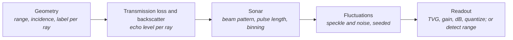

# Sonar simulation design

Status: draft, 2026-11-20.

## Use cases

The sonar simulation exists so that a team can develop underwater perception and mapping in simulation and run the same pipeline on the real vehicle. The driving case is the Virtual RobotX 2027 competition, but the needs are generic to small marine robots working in shallow harbor water:

1. Detect and classify objects underwater, from a strong, simple target (a hollow sphere) up to lookalike shapes, low-contrast objects and clutter near structures, including when the camera cannot see.
2. Measure the range and bearing to a nearby object precisely enough to report its position in the world.
3. Decide whether a space (a dock bay, a route) is clear of submerged obstructions.
4. Survey an area and produce a georeferenced map product of the seabed and an object on it, such as a shipwreck, from a surface vehicle, an underwater vehicle, or both. For development, the map product is a georeferenced point cloud that fuses sonar data with the vehicle's positioning, and it is scored by its geometric difference from the simulation's ground truth.

The water is shallow: nominally 3 to 12 m, at most 30 m.

The simulation is used for scored competition runs as well as development, so it must be repeatable from a seed, run on the evaluation hardware alongside several vehicles, and expose difficulty through a small set of documented parameters. The scoring hardware has a GPU, and the sonar must hold its configured rate there; it must also run, more slowly, on any machine that can run Gazebo's cameras, so that no team needs a GPU to develop.


Three types of sonar: the same engine, with different geometry.


## Sonars in scope

| Sonar | Where | Use cases | Exemplar | Native product of the exemplar |
|---|---|---|---|---|
| Imaging sonar (forward-looking multibeam) | UUV, looking forward | 1, 2, 3 | Sonoptix ECHO (defaults): 400 kHz to 100 m or 700 kHz to 30 m, 256 beams over 90° or 120°, 20° vertical, up to 25 Hz. Also, for example, Teledyne BlueView M900-130 Mk2: 900 kHz, 130°, to 100 m | uint8 matrix, one column per beam and one row per range sample |
| Profiling sonar (downward multibeam) | UUV looking down, or USV | 4 | Cerulean Surveyor 240-16 (defaults): 240 kHz, angle of arrival, 4° along track by 80° across, 10 to 20 soundings per ping, up to 100 m, up to 20 Hz. Also, for example, a beamformed profiler such as the Teledyne Odom MB2: 200 to 460 kHz, 1.8° by 1.8° beams | Soundings: a range and an angle per detection, sometimes with water-column intensity |
| Sidescan | USV, one bar under the hull with a transducer on each side | 4 | Cerulean Omniscan 450 SS: 450 kHz, 0.5° along track by 50° vertical, up to 150 m, up to 20 Hz | One line per ping: 200 to 1200 uint16 samples in dB, with range start, length, gain and sound speed |

A UUV carries a sonar looking forward, one looking down, or both; the BlueROV2's chassis has one sonar slot, for the Ping360, so these sonars go on by free placement. A USV carries the sidescan, the profiling sonar, or both.

Out of scope: single-beam echosounders and altimeters, interferometric sidescan, synthetic aperture sonar, sub-bottom profilers, mechanically scanned sonars (imaging or profiling), 3D sonars with a two-dimensional receive array, acoustic positioning (USBL, LBL) and acoustic communication, which is a separate design.

The three sonars differ in where they point and how wide the beam is in elevation, not in the underlying physics. An imaging sonar has a beam wide in elevation: every pixel sums echoes from a tall wedge of water, so the image shows the scene's appearance (highlights, shadows) but loses each return's elevation. A profiling sonar has a beam narrow in elevation, so each beam's strongest return fixes a point in 3D, and the vehicle's motion sweeps the profile into bathymetry. A sidescan is a single fan-shaped beam per side, swept along the track by the vehicle's motion.

### Glossary

How this project uses the terms. The field uses several of them loosely, so the synonyms column says what else a reader may meet and what we avoid.

| Term | How we use it | Synonyms and terms we avoid |
|---|---|---|
| Multibeam sonar | A sonar whose array forms many beams at once, side by side across a fan. In this project a multibeam sonar is either an imaging sonar or a profiling sonar. | "Multibeam" alone means a profiling sonar to hydrographers and often an imaging sonar in robotics papers; we always say which. |
| Imaging sonar | A multibeam sonar whose beams are wide in elevation. Its product is an intensity image in range and bearing; the elevation of each return is lost. | Forward-looking sonar (FLS), multibeam imaging sonar, 2D sonar, acoustic camera (usually for the highest-frequency units). We avoid FLS as a type name, because it names the pointing direction: a profiler or a 3D sonar can also look forward. |
| Profiling sonar | A multibeam sonar that ensonifies a thin fan, narrow along track and wide across it. Inside the device it has the echo intensity of the fan in angle and range, a thin-slice image of the scene; it detects the bottom in it, rejects outliers, and delivers soundings: a range and an angle per detection. Motion sweeps the profiles into bathymetry. | Multibeam echosounder (MBES), bathymetric multibeam, swath sonar, multibeam profiler. Water column is the name for the intensity before detection, when a device exposes it. Not a sub-bottom profiler, which images layers beneath the seabed. |
| Sidescan sonar | One beam per side, narrow along track and wide in elevation, pointing sideways. Each ping gives one intensity line per side; motion along the track builds the image. | Side-scan, side scan, SSS. It is not a multibeam sonar in this project. |
| Ping | One transmission and the echoes received from it. | Shot, frame (for an imaging sonar's image). |
| Beam | One direction the sonar resolves within a ping. | Channel (in some vendor formats). |
| Sample | One time step of a beam's received echo, which corresponds to one range, at 2R/c. | Range bin, bin, row (in the ECHO's matrix). |
| Azimuth, elevation | The angles across a fan and out of it: for an imaging sonar, horizontal and vertical; for a sidescan, along track and across the swath. | Horizontal and vertical field of view (FOV), beam width and beam height (Cerulean). |
| Beam width | The angle between the −3 dB points of a beam's two-way response. | Beam angle, opening angle. |
| Incidence angle, grazing angle | The angle between the ray and the surface normal (incidence), or between the ray and the surface itself (grazing). They add to 90°. | Angle of incidence. Seabed backscatter is usually quoted against grazing angle. |
| Waterfall, mosaic | A waterfall stacks sidescan lines in ping order, in the sonar's own frame. A mosaic places them in the world from the vehicle's position and heading. | Sidescan image, georeferenced image. |


## Related work

A survey of the field in November 2026 found the following. Its full notes are in the maritime-workspace repository.

| Simulator | Sonar model | Fidelity | What we take from it |
|---|---|---|---|
| DAVE, now [IOES-Lab/POSIM](https://github.com/IOES-Lab/POSIM) (Gazebo Jetty, ROS 2 Lyrical, Apache-2.0) | Point scattering on depth-camera rays, complex Gaussian amplitudes, beam pattern, per-beam time series; CPU, CUDA and WGPU back ends; publishes `marine_acoustic_msgs/ProjectedSonarImage` | Coherent point scattering on rasterized geometry, the only open model at this level | The output contract, the depth-camera sampling, and the scattering formulation, as ideas and, where useful, adapted code. Its absorption constant suits about 100 kHz rather than the MHz heads it ships, its back ends disagree numerically, and it has not been validated quantitatively against real data |
| [HoloOcean](https://github.com/byu-holoocean/HoloOcean) (Unreal) | Octree, ray-cast and GPU back ends; cosine and impedance shading, mean per bin, heuristic noise; imaging, profiling, sidescan, single beam | Geometric (octree projection; ray casting in HoloOcean 2.0) with partial intensity physics | That one engine can serve imaging, profiling and sidescan by configuration. Averaging per bin, instead of summing, removes the dependence on ensonified area |
| [Stonefish](https://github.com/patrykcieslak/stonefish) (OpenGL, GPL-3.0) | Rasterize and bin per beam column; correct ping timing from 2R/c | Image-based to geometric | Ping timing; the GPL rules out reusing code |
| [OceanSim](https://github.com/umfieldrobotics/OceanSim) (Isaac Sim) | GPU ray-traced point cloud, cosine and attenuation, normalized by range | Geometric | Normalizing per frame or row erases the absolute intensity that classification needs |
| [MARUS](https://github.com/MARUSimulator) (Unity) | CPU ray casts, cosine-squared shading; labeled dataset export | Geometric | Per-return object labels for training data |
| [SMaRC](https://github.com/smarc-project) (Unity, plus auvlib) | Cheap runtime sidescan with the real vehicle's message; differentiable renderers fitted to real surveys offline | Geometric at run time | A sidescan message modeled on the real sensor's packet, so the same consumer runs on both |

Three findings carry into this design. None of the perception simulators puts the geometry (beam angles, range per sample) in its output, so a consumer receives a picture without its coordinate system. Where users have measured transfer to real data, geometric tasks transfer (feature matching trained on HoloOcean beat LightGlue on real tank data) and intensity and noise do not (a HoloOcean-trained denoiser failed on real data). And Gazebo itself has no sonar sensor; gz-sensors issue #19 has been open since 2020.

## Theory of operation

The engine is an **incoherent sonar-equation model on rendered geometry**: Gazebo renders the surfaces the sonar sees, and the sonar equation turns each into echo power, added without phase.

For each beam and range sample the echo power from every surface patch the beam sees is summed, using the sonar equation: two-way spherical spreading, Francois–Garrison absorption, the patch's backscatter strength times the area the beam ensonifies, and the two-way beam pattern. Backscatter follows Lambert's law (μ cos² of the incidence angle) plus a Gaussian specular lobe near normal incidence. Phases are never computed, so the model is incoherent: the interference between scatterers is applied afterward as speckle, an exponentially distributed multiplier on intensity.

This section describes, at a high level, the model component by component, with references for the details; places it among the alternative approaches; justifies why it suits the driving use cases; and then describes how the one model is adapted to the different sonar types: the multibeam sonars (imaging and profiling) and the sidescan.

### The model and its components

All three sonars use this one engine, also called an incoherent intensity model. It treats every surface the sonar sees as a patch made of many small, independent scatterers, and its result is the echo intensity in every beam and range sample, which a readout then turns into what the real device delivers. Coiras and Groen, ["Simulation and 3D reconstruction of side-looking sonar images"](https://doi.org/10.5772/39406) (in *Advances in Sonar Technology*, 2009, open access), derive this model in "Sonar simulation": from the wave equation and point scattering down to the Lambertian, incoherent form used here. Sena and Santos Neto, ["SideScanSim: an open-source side-scan sonar simulator"](https://sol.sbc.org.br/index.php/erbase/article/download/46318/46077/) (2026, with an [open implementation](https://github.com/andreluissena/SideScanSim)), write out the same ingredients in a few lines each: the sonar equation with spreading and Francois–Garrison absorption, Lambert's law for the seabed, time-varied gain, and speckle as an exponentially distributed intensity. Short introduction to the ["SONAR equation"](https://dosits.org/science/advanced-topics/sonar-equation/).

The engine follows the terms of the active sonar equation, received level = source level − 2 TL + BS + 10 log A, weighted by the beam pattern, in six components:

| Component | Sonar-equation term | What we model |
|---|---|---|
| Geometry | Which surfaces the sonar sees, at what range and incidence | Rays sampled from depth and segmentation cameras; the first hit only, which gives shadows |
| Transmission loss | 2 TL | Straight paths, one sound speed, two-way spherical spreading and Francois–Garrison absorption |
| Backscatter | BS + 10 log A | Lambert's law plus a specular lobe, per surface, times the area each ray covers |
| Sonar | Source level, directivity and range resolution | The two-way beam pattern with its sidelobes and vertical taper, the beams, the pulse length and range samples |
| Fluctuations | The statistics of the received level | Speckle as an exponentially distributed multiplier, and a noise floor |
| Readout | What the device delivers | Time-varied gain, gain, dB and 8-bit levels, or bottom detection |

The contribution of a ray hitting a surface at range R and incidence θ is proportional to b²(φ, ψ) · σ(θ) · A / R⁴ · 10^(−2αR/10), where b is the one-way beam pattern at the ray's azimuth φ and elevation ψ, A = R² ΔΩ / cos θ is the area the ray's solid angle ΔΩ covers on the surface, and α is the absorption in dB per meter. The source level is a constant, which the readout's gain absorbs.



#### Geometry

For each ping, a fan of rays covers the sonar's field of view at finer resolution than the beams, in azimuth and in elevation. In elevation the rays reach past the beam's −3 dB edge, to `elevation_span` half-widths of the vertical beam (three for the imaging sonar, where the pattern is 27 dB down), so the seabed shows faintly before the main beam reaches it, as on a real sonar; the fan then stops, a sampling limit rather than physics. Each ray returns the range to the first surface it hits, the incidence angle there, and the acoustic properties of that surface. Taking only the first hit along each ray produces acoustic shadows without any extra step. In Gazebo the rays come from gz-rendering: a depth camera gives the range, read at each ray's exact direction by interpolating 1/z between pixels, which is exact on a plane; a segmentation camera gives the entity hit; and normals come from neighboring hits on the ray grid; a hit whose normal cannot be estimated, on an object one ray wide, is given an incidence of 45°, a plain diffuse return with no glint, rather than the strongest return head on. Phase 1 measured this at 0.02 mm median range error on a box on a seabed; gz-rendering's ray sensor (GpuRays) was rejected for an error floor of about 8 mm and no normals. Depth cameras report depth along their optical axis, which the sampler converts to range along the ray.

#### Transmission loss

Two-way spherical spreading, 1/R⁴ in intensity (40 log R in dB), and absorption over the two-way path. Absorption comes from the Francois–Garrison equations at the configured frequency, temperature and salinity, at the surface, not from a fixed constant. The shallow, near-isovelocity water lets the engine ignore refraction and propagation modeling: paths are straight, and sound speed is a single configured value. Multipath, the bounces off the surface and the seabed that matter for a sidescan in shallow water, is not modeled yet; the water surface is hidden from the sonar.

#### Backscatter

The backscatter is σ(θ) = μ cos²θ + S exp(−θ²/2w²): Lambert's law for rough, diffuse scattering, per unit area (μ times the square of the sine of the grazing angle), with μ a property of the surface, plus an optional Gaussian specular lobe of strength S and angular width w for smooth objects, which return strongly only near normal incidence. The square comes from the two legs of a monostatic sonar: a tilted patch both intercepts less of the beam and scatters less of it back. Because the engine multiplies σ by the area each ray covers, which grows as 1/cosθ, one ray's return falls as cosθ, the same curve as the optical cosine shading many simulators apply per hit. What the sonar equation adds is the scale: μ is a measured backscatter strength, so the seabed values in the literature apply directly, and summing over area makes a return follow the area the beam ensonifies. Lambert's law is the standard first-order law for diffuse seabed backscatter, with one parameter (Mackenzie measured μ ≈ −27 dB), and fits at intermediate grazing angles; near normal incidence the specular lobe takes over, and at very low grazing angles real seabeds depart from it. A richer law, such as the APL-UW models, would drop into the same place. Each surface's values come from SDF, as described in [Acoustic properties of the scene](#acoustic-properties-of-the-scene).

#### Sonar

Each ray's contribution is added (not averaged) into the beams according to the beam pattern, so sidelobes appear around bright targets, and into the range sample at 2R/c, spread uniformly over the wider of the pulse length and the range interval the ray's footprint covers on a slanted surface. The sampler measures that interval from the ranges the ray's neighbors on the grid hit on the same surface: on a plane seen at a grazing angle the footprints meet and leave no empty samples, and at the edge of a target, where the neighbor misses it, the footprint stays small instead of smearing the target in range. Without neighbors the engine estimates it from the incidence angle, capped at 8 samples. Summing over the elevation of a beam reproduces the imaging sonar's elevation ambiguity; for the narrow beams of the profiler and the narrow along-track width of the sidescan it collapses to almost nothing.

#### Fluctuations

Each sample's intensity is multiplied by an exponentially distributed random factor, the statistics of fully developed speckle from many unresolved scatterers, and an additive noise floor is applied. Every random draw comes from a generator seeded from the sonar system's `<seed>`, the sensor's name and the ping number, so a run is reproducible.

#### Readout

What a real device delivers differs by sonar, so the readout does too: an 8-bit image for the [imaging sonar](#imaging-sonar), a line in dB for the [sidescan](#sidescan), and soundings for the [profiling sonar](#profiling-sonar).

### Acoustic properties of the scene

Each surface needs the two backscatter terms above: the Lambert strength μ and, for smooth objects, the specular strength S and width w. Materials of a mesh part live in its `.glb`, and the SDF `<visual>` of a `.glb` must not declare a `<material>`, so acoustic properties cannot come from SDF materials; the simple targets in `gz_sonar`, primitives with no mesh, keep an SDF material for their color. They are set with `gz:` custom elements, the way the project already marks collisions for buoyancy and wind. Strengths are in dB (10 log₁₀ μ and 10 log₁₀ S), the form backscatter is quoted in the literature, and the width is in radians, as SDF gives every angle. Ground truth labels come from the same pass: each ray knows which entity it hit. Labels are the segmentation camera's 8 bits, one id per model and property set for the whole world, so a world can tell 254 surfaces apart; past that, the rest share one id with the default properties, and labeling per ping by range is the way beyond it.

Nothing has to be marked for the sonar to see it. Every surface gets values from the first of these that sets them:

1. Elements on the visual the ray hit.
2. Elements directly under its model, which apply to all of the model's visuals, so a model of many parts is marked once.
3. The world's `<default>` in the sonar system.
4. The built-in default: −20 dB Lambert, no specular term.

So an unmarked model is a plain diffuse scatterer, and marking is only needed for the objects a task depends on: targets, lookalikes, the wreck. The specular term is never on by default, because a glint on every flat face would make everything look smooth.

The seabed is named in the world rather than marked, because site worlds take their terrain from Fuel models that we do not edit: the sonar system's `<seabed>` lists the seabed models and their values. Three kinds of surface return no echo at all: the water surface drawn by `gz_waves_rendering`, which the engine hides from its cameras; the model that carries the sonar, so a hull or mount never echoes into its own sensor; and anything marked `<gz:acoustic_transparent/>`, for visual-only objects such as markers above the water.

```xml
<!-- A hollow glass float: smooth, so weak diffuse scattering and a strong
     specular glint when the sonar looks at it head on. -->
<visual name="float">
  <geometry><sphere><radius>0.2</radius></sphere></geometry>
  <gz:acoustic_lambert>-30</gz:acoustic_lambert>
  <gz:acoustic_specular>-3</gz:acoustic_specular>
  <gz:acoustic_specular_width>0.07</gz:acoustic_specular_width>
</visual>

<!-- A course marker that is only for the cameras. -->
<visual name="flag">
  <gz:acoustic_transparent/>
</visual>

<!-- In the world: the water, the seabed, and the default for anything unmarked. -->
<plugin filename="gz-maritime-sonar-system" name="gz::sim::maritime::Sonar">
  <temperature>29</temperature>
  <salinity>30</salinity>
  <seabed>
    <model>marina_bay</model>
    <lambert>-27</lambert>
  </seabed>
  <default><lambert>-20</lambert></default>
</plugin>
```

The values are illustrative, not calibrated: around −27 dB is a common Lambert figure for a sandy seabed.

The full set of acoustic properties, with a sense of scale for each. The figures are order-of-magnitude guides for choosing values, to be checked against the cited sources before anything is calibrated.

On a visual, or directly under a model:

- `gz:acoustic_lambert`: diffuse backscatter strength, in dB ([APL-UW high-frequency environmental acoustic models handbook, TR 9407](https://apps.dtic.mil/sti/pdfs/ADB199453.pdf)). Seabeds run from about −40 dB (soft mud) through −30 to −25 dB (sand) to −20 to −10 dB (gravel, rock); −27 dB is the classic single figure. The built-in default for objects is −20 dB.
- `gz:acoustic_specular`: strength of the glint near normal incidence, in dB ([Jackson, "Models for scattering from the sea bed"](https://www.ioa.org.uk/system/files/publications/DR%20JACKSON%20MODELS%20FOR%20SCATTERING%20FROM%20THE%20SEA%20BED.pdf)). From about −20 dB, a faint glint off a rough surface, to around 0 dB for smooth, hard surfaces such as glass, metal plate or concrete. Off unless set.
- `gz:acoustic_specular_width`: angular width of that glint, in radians ([Jackson and Richardson, High-Frequency Seafloor Acoustics](https://link.springer.com/chapter/10.1007/978-0-387-36945-7_6)). From 0.02 to 0.03 (1 to 2°) for very smooth surfaces to 0.17 to 0.35 (10 to 20°) for rough ones; about 0.07 (4°) suits most man-made objects.
- `gz:acoustic_transparent`: the sonar does not see this surface. Present or absent.

In the world's sonar system:

- `<seabed>`: the seabed models and their Lambert and specular values ([APL-UW TR 9407](https://apps.dtic.mil/sti/pdfs/ADB199453.pdf)). Same scale as above; a harbor floor of silty sand is around −30 dB.
- `<default>`: values for any surface not otherwise set. Same scale as `gz:acoustic_lambert`; −20 dB if the world sets nothing.
- `<temperature>`, `<salinity>`: water properties that set absorption at each sonar's frequency ([Francois and Garrison 1982](https://data-ww3.ifremer.fr/BIB/Francois_Garrison_JASA1982.pdf); [MB-System mbabsorption](https://www.ldeo.columbia.edu/res/pi/MB-System/mbweb/html/mbabsorption.html)). Temperature from 0 to 30 °C, with Singapore harbor water around 29 to 30 °C; salinity from 0 PSU (fresh) to 35 PSU (open ocean), with harbors and estuaries often 20 to 32 PSU. The resulting absorption, at 10 °C and 35 PSU, is roughly 0.03 dB/m at 100 kHz, 0.1 dB/m at 450 kHz and 0.3 dB/m at 900 kHz, rising steeply above 1 MHz.
- `<seed>`: where every sonar's random draws start, mixed with each sensor's name and the ping number, so two sonars in one world draw differently and a run repeats. An integer; 0 by default, which is a seed like any other.
- `<sound_speed>`: one value for the whole water column, which sets range from travel time ([speed of sound in seawater](https://en.wikipedia.org/wiki/Speed_of_sound#Seawater)). From about 1400 m/s (cold fresh water) to 1550 m/s (warm salt water); 1500 m/s is the nominal value, and warm tropical harbor water is around 1540 m/s. It is set on its own, not derived from the temperature and salinity, which set only absorption; a world that wants the two to agree sets the value they give.

### Where it sits among the alternatives

The alternatives, from least to most physical, and so from least to most computation. Neither acousticians nor roboticists share one set of names for them, and robotics papers call the second, third and fourth all "physics-based", so we name each by what it computes and list the other names a reader will meet.

| Model | Also called | What it does | Examples | Why not here |
|---|---|---|---|---|
| Image-based conversion | Depth-camera based, image processing | Renders the scene with a camera, as depth or normals, and converts the picture into a sonar fan | The depth-camera sonar of UUV Simulator and DAVE, UWSim, ACOUSIM ([Basha S and Nambiar 2026](https://arxiv.org/abs/2605.19712)) | Intensities are not physical and often normalized away, and the output carries no geometry; classification cues are not trustworthy |
| Geometric model with Lambertian shading | Ray tracing or ray casting, rasterization, octree projection, tube tracing; geometry-driven ([Attia et al. 2026](https://arxiv.org/abs/2606.06130)) | Finds range, bearing and shadows from the geometry, by casting rays or rasterizing, and shades each hit with a cosine law | HoloOcean (octree projection in [Potokar et al. 2022](https://publications.ri.cmu.edu/resolve/2022/10/Potokar22icra.pdf), ray casting in HoloOcean 2.0), OceanSim (GPU ray tracing, [Song et al. 2025](https://arxiv.org/abs/2503.01074)), Stonefish, MARUS | Range, bearing and shadows are right, but brightness does not follow the area seen, absorption or the beam pattern, which is where the harder detection and classification levels live |
| Sonar-equation model | Incoherent intensity model; energy based ([Guériot and Sintes 2011](https://doi.org/10.5772/18029)) | As described above | This design; SideScanSim | |
| Coherent point-scattering model | Point-based scattering model ([Brown et al. 2017](https://doi.org/10.1121/1.4976584)), point scatterer approach, time-series model; for large targets, facets with the Kirchhoff approximation | Gives each scatterer a complex amplitude and sums the waves in each beam, so speckle and sidelobes emerge from interference | DAVE, now POSIM ([Choi et al. 2021](https://doi.org/10.3389/frobt.2021.706646)); Penn State's PoSSM | Heavier, usually needing a GPU toolkit, and the phase it computes is never seen by a team, which receives beamformed intensity |
| Propagation-model driven | Acoustic propagation models (ray tracing such as Bellhop, normal modes, parabolic equation); the nearby established term, sonar performance model, predicts detection rather than images | Adds sound-speed refraction, multipath and reverberation from ocean acoustic propagation models | APL-UW's Sonar Simulation Toolset ([TR 0702](https://www.apl.washington.edu/research/downloads/publications/tr_0702.pdf)) | Built for sonar design, not for real-time robotics, and unnecessary in water no deeper than 30 m |

The backscatter law is a separate choice from the model: Lambert's law, the Kirchhoff approximation, small-roughness perturbation, or the APL-UW models, any of which the second to fourth models can use. Ours, and why we chose it, is under Backscatter in [The model and its components](#the-model-and-its-components).

We use POSIM, the continuation of DAVE's multibeam model ([Choi et al. 2021](https://doi.org/10.3389/frobt.2021.706646)), as the principal constraint and comparison for this design: the reference one level up. It samples the scene the same way, with a depth camera, and adds what our model approximates: the phase of each echo, so speckle and sidelobes come out of interference instead of being applied statistically. Each phase compares our images with POSIM's on the same scene. That is one simulation against another, both approximations, so POSIM is not taken as truth and does not over-constrain the design. Agreement, as on target ranges, bearings and shadows, says the incoherent approximation is enough for the driving use cases. A difference should trace to a known difference between the models, such as our tapered vertical beam against its hard ±10° edge, our per-surface backscatter against its single reflectivity, or our shaded sidelobes against its beam pattern; where it traces to a deliberate choice of ours, we keep the choice rather than match POSIM. Its backscatter is simpler than ours, the same Lambert form with one reflectivity for every surface and no specular term, so the comparison checks how the image is formed, not the backscatter.

### Why this level suits the use cases

In the driving use cases, perception consumes what a real sonar delivers after beamforming, and mapping consumes soundings. The simulation produces exactly those data artifacts: for the imaging sonar, a matrix of 8-bit intensities with one column per beam and one row per range sample, which a viewer draws as a fan-shaped image; for the sidescan, one line of intensities in dB per ping, which the consumer stacks into a waterfall and georeferences into a mosaic; and for the profiling sonar, soundings, a travel time and an angle per detection, which the consumer turns into a point cloud. This level matches the focus of the challenge, which is classification and shared autonomy, not beamforming and signal processing.

### Imaging sonar

Configured as a fan of N beams over the horizontal field of view, wide in elevation, pointing forward with a configurable tilt. Readout: time-varied gain for spreading and absorption, `tvg_spreading`·log₁₀R + 2αR in dB (30 log R by default), then the gain, which sets full scale (automatic by default), then a fixed mapping of the top `dynamic_range` dB below full scale (60 by default) onto 1 to 255, linear in dB, with 0 for anything weaker, giving the device's 8-bit beam × sample matrix. Thresholding and color maps, which the ECHO's own viewer applies with its dark point, white point and color map settings, are display choices left to the consumer. The configuration covers wide-fan imaging sonars such as the Sonoptix ECHO and the Teledyne BlueView M900-130 Mk2 (900 kHz, 130°, to 100 m); we use the ECHO for defaults: 256 beams over 120° at 700 kHz, 20° vertical, a 10 µs pulse (7.5 mm in range), and 1024 samples over the range window, set with `samples`.


### Profiling sonar

A real profiling sonar works in three stages: it ensonifies a thin fan, forms the echo intensity across the fan in angle and range, then detects the bottom and rejects outliers on the device, delivering soundings. The simulation follows the same stages.

1. The engine runs exactly as for the imaging sonar, configured as a fan that is narrow along track (a few degrees) and wide across track, pointing down. It produces the intensity matrix of the thin slice, beam by range sample.
2. The readout detects the bottom in that matrix. A beamformed readout takes, per beam, the strongest return above a threshold and flags returns inconsistent with their neighbors; an angle-of-arrival readout keeps the strongest echo in each of `max_soundings` sectors of the fan. Both add range noise that grows as the signal-to-noise ratio falls. Where nothing exceeds the threshold, as at grazing angles and over weak surfaces, the beam drops out.
3. The soundings are published, a two-way travel time and an angle per detection. Optionally the intensity matrix from step 1 is published as well, as water-column data, so a team can write its own bottom detection; it is on by default only if the exemplar exposes it.

Devices differ in how they get the angle, and the readout covers both. A beamformed profiler reports one sounding per beam at fixed beam angles. An angle-of-arrival profiler, such as the Cerulean Surveyor 240-16, transmits one thin fan (4° by 80°), estimates the direction of the strongest echoes from a small receive array (16 elements), and reports a variable number of soundings per ping (10 to 20), each with its own angle; the device reports no intensity, and the simulation fills in the detected level. For the second kind, the readout keeps the strongest detection in each of N sectors across the fan, with angle noise. Neither kind needs phase in the simulation, because only the soundings leave the device.

The bathymetric work that a large-ocean multibeam needs (sound-speed ray tracing, multi-sector timing) is unnecessary at 30 m or less. We use the Surveyor 240-16 for defaults: angle-of-arrival readout, 240 kHz, a 4° by 80° fan, up to 20 soundings per ping, 200 to 800 range steps; the simulation's default window reaches 50 m, the device up to 100 m. The same sensor mounts under the BlueBoat or on the base of the BlueROV2, looking down.

### Sidescan

Configured as one beam per side, narrow along track and wide in elevation, pointing to the side with a depression angle set by the mount; on the BlueBoat each side points 15° down. One ping produces one line; the line-by-line waterfall and any mosaic are built by the consumer from the vehicle's motion, as with the real sensor, so the vessel's roll, pitch and yaw enter the data without special handling. Readout: each sample in dB as float32, with time-varied gain for spreading and absorption applied by default, as sidescan viewers expect. The time-varied gain is an exact term, `tvg_spreading`·log₁₀R + 2αR in dB, and the gz-transport message carries it for every sample along with the gain, so a consumer can take both out; `marine_acoustic_msgs/ProjectedSonarImage` has no field for either, so on the ROS side `tvg` set to `none` and a fixed `gain` publish the received level directly. Automatic gain is smoothed across pings with a time constant of about a second, as real sidescans do: set ping by ping, it darkens every line that holds a bright target and stripes the waterfall, as Phase 1 showed. The Omniscan scales its dB values into uint16 for its link, which the simulation has no need to copy. The Omniscan defaults: 450 kHz, 0.5° by 50°, no tilt, 600 samples, far field beyond 9 m. The nadir gap, the first bottom return, and the grazing-angle dependence of the seabed return all follow from the geometry and the backscatter law.

## Interface

### SDF

Each sonar is a gz-sensors custom sensor, the pattern `gz_wind`'s anemometer already uses: `<sensor type="custom" gz:type="imaging_sonar">`, `gz:type="sidescan_sonar"` or `gz:type="profiling_sonar"`, with the standard `<update_rate>`, `<topic>` and `<pose>`, and a `<gz:sonar>` block. Every element in the block is optional, and an empty block gives the exemplar for that type:

```xml
<sensor name="sonar_forward" type="custom" gz:type="imaging_sonar">
  <pose>0.2 0 -0.1 0 0.26 0</pose>
  <update_rate>10</update_rate>
  <topic>bluerov2/sonar_forward/image</topic>
  <gz:sonar>
    <frequency>700000</frequency>
    <horizontal_fov>2.094</horizontal_fov>
    <vertical_fov>0.349</vertical_fov>
    <beams>256</beams>
    <beam_width>0.026</beam_width>
    <range><min>0.2</min><max>30</max></range>
    <samples>1024</samples>
    <noise_floor>-50</noise_floor>
  </gz:sonar>
</sensor>
```

The sensor's x axis is the acoustic axis, the direction the sonar looks; the pose points it forward, down or to the side. The fan spans the horizontal field of view about the sensor's z axis and the vertical field of view about its y axis. So the same two parameters describe all three types: an imaging sonar's wide horizontal fan and 20° of elevation, a profiler's 80° across-track fan and 4° along track, and a sidescan's 0.5° along track and 50° of elevation.

Parameters shared by the three types. The defaults come from each type's exemplar where its documentation gives a value; "chosen" marks a value the exemplar does not document, set to something plausible.

| Parameter | Meaning | Imaging (ECHO) | Profiling (Surveyor 240-16) | Sidescan (Omniscan 450 SS) | Typical range |
|---|---|---|---|---|---|
| `<update_rate>` (sensor) | Pings per second; the engine also caps it at c/2R so one ping's echoes return before the next | 10 Hz (up to 25) | 10 Hz (up to 20) | 10 Hz (up to 20) | 1 to 25 Hz |
| `frequency` | Center frequency in Hz; sets absorption | 700 000 | 240 000 | 450 000 | 200 kHz to 2.25 MHz |
| `horizontal_fov` | Width of the fan about the sensor's z axis, rad | 2.094 (120°) | 1.396 (80°) | 0.0087 (0.5°) | 0.5° to 140° |
| `vertical_fov` | Thickness of the fan about the sensor's y axis, rad | 0.349 (20°) | 0.070 (4°) | 0.873 (50°) | 1° to 50° |
| `beams` | Beams across the fan | 256 | 160 (the fan's intensity before detection; the soundings per ping are `max_soundings`) | 1 | 1 to about 1000 |
| `beam_width` | Two-way −3 dB width of one beam across the fan, rad | 0.026 (1.5°) | 0.017 (1°, chosen) | the horizontal FOV | 0.25° to 3° |
| `sidelobe_level` | First sidelobe relative to the main lobe, dB | −25 (chosen, typical of a shaded array) | −13 (chosen) | −13 (chosen) | −13 (unshaded array) to −40 (heavily shaded) |
| `range/min`, `range/max` (or `range_min`, `range_max`) | Range window, m | 0.2, 30 | 2.5, 50 | 1 (chosen), 50 | min 0.1 to 5; max 5 to 300 |
| `samples` | Range samples per beam per ping | 1024 (chosen) | 400 | 600 | 200 to 4000 |
| `pulse_length` | Transmit pulse, s; sets range resolution cτ/2 | 1e-5 (7.5 mm) | 1e-4 (chosen) | 1e-4 (chosen) | 10 to 200 µs |
| `sound_speed` | Speed the device assumes when it converts time to range, m/s. The world's `<sound_speed>` is the truth; a difference between them biases every range, as a mis-set sonar does | the world's value | the world's value, reported in the message only, since soundings are travel times | the world's value | 1400 to 1550 |
| `gain` | Receiver gain before readout: `auto`, which puts the median echo 24 dB below full scale but never clips more than the brightest 0.1 % of echoes, or a fixed value in dB | auto | auto | auto | auto, or 0 to 60 dB |
| `gain_time_constant` | How quickly automatic gain follows the scene, s; 0 sets it from each ping alone | 0 | 0 | 1 | 0 to 5 |
| `tvg` | Time-varied gain: `none`, `spreading` or `spreading_absorption` | spreading_absorption | none | spreading_absorption | one of the three |
| `tvg_spreading` | The spreading term of the time-varied gain, dB per decade of range: `tvg_spreading`·log₁₀R | 30 | 30 | 30 | 20 to 40 |
| `noise_floor` | Additive noise relative to the readout's full scale, dB; higher is harder | −50 | −50 | −50 | −80 (quiet) to −20 (noisy) |
| `speckle` | Multiply each sample by the speckle factor | true | true | true | true or false |
| `labels` | Publish the ground-truth labels topic, `<topic>/labels` | false | false | false | true or false |

Readout parameters that only one type uses:

| Type | Parameter | Meaning | Default | Typical range |
|---|---|---|---|---|
| Imaging | `dynamic_range` | The levels below full scale that the 8-bit readout spans, dB | 60 | 40 to 80 |
| Profiling | `readout` | How angles are found: `beamformed` (one sounding per beam) or `angle_of_arrival` (the strongest echoes, any angle) | angle_of_arrival | either |
| Profiling | `max_soundings` | Angle-of-arrival readout: the fan's sectors, so the most soundings per ping | 20 | 10 to 40 |
| Profiling | `detection_threshold` | Echo level above the noise floor that counts as a sounding, dB | 10 (chosen) | 3 to 20 |
| Profiling | `range_noise` | Standard deviation of range at high signal-to-noise ratio, m; grows as the ratio falls | half a range step (chosen; the Surveyor's precision is not published) | 0.005 to 0.1 |
| Profiling | `angle_noise` | Standard deviation of a sounding's angle, rad | 0.009 (0.5°, chosen) | 0.1° to 2° |
| Profiling | `water_column` | Also publish the thin-fan intensity before detection | false | true or false |

Advanced: geometry sampling. These set how finely the engine samples the scene, not anything about the sonar, and the defaults are chosen for accuracy. Lowering them is the way to buy speed, at the cost of fidelity; see [Performance](#performance).

| Parameter | Meaning | Imaging (ECHO) | Profiling (Surveyor 240-16) | Sidescan (Omniscan 450 SS) | Trade-off |
|---|---|---|---|---|---|
| `rays_per_beam` | Rays across one beam width | 4 | 4 | 8 | The largest lever: the cameras' width and the work per ping scale with it. Below 4, small targets and edges fall between rays and shadows lose detail; 2 is the practical minimum |
| `elevation_rays` | Rays across the vertical field of view, counted at a span of 2 | 64 | 16 | 400 | Fewer rays leave gaps in range on surfaces seen at grazing angles, which the footprints from neighboring rays only partly fill |
| `elevation_span` | How far the rays reach out of the fan, in half-widths of the vertical beam; the ray count scales with it | 3 | 2 | 2 | Wider shows more of the faint seabed below the beam; 3 costs about 50 % more rays than 2 |

The imaging sonar's readout is fixed: 8-bit beam by sample, as the ECHO delivers it.

A world system, `gz::sim::maritime::Sonar` in `gz-maritime-sonar-system` (the counterpart of the wind system), owns the water properties and the scene's acoustic defaults described above, and drives every sonar sensor in the world, including those on vehicles spawned at run time. It draws each sonar's cameras on the rendering thread of gz-sim's Sensors system, which the world must load, and joins that thread's render events only while the world has a sonar: a connected render event makes the rendering thread run every physics step, so a world without a sonar pays nothing. It belongs in the `<world>`, once. Pings are scheduled in nanoseconds of sim time on each sonar's rate grid, ping k at k divided by the rate, and stamped with the time of the scene they saw; a slow ping holds the simulation back rather than being dropped. A sonar or target spawned or removed at run time takes effect at the first frame after the update that made the change, so it reaches the same ping in every run, and a world reset starts every sonar over on its grid. The output stays a function of the seed, the scene and its changes. A vehicle described by a parts config, as the BlueROV2 and the BlueBoat are, passes a `sonar:` dict on the part's entry into this block, one element per key.

### Messages

| Sonar | ROS 2 message | Notes |
|---|---|---|
| Imaging | `marine_acoustic_msgs/ProjectedSonarImage` | Beam directions, the range of each sample, frequency, sound speed and beam widths, and the uint8 beam × sample data, in one message |
| Profiling | `marine_acoustic_msgs/SonarDetections` | Per sounding: two-way travel time, across-track angle (`rx_angles`), along-track angle (`tx_angles`), intensity and a flag (OK, or rejected by the sonar or by a filter). The arrays can change length from ping to ping, so a variable number of soundings fits. This mirrors the Surveyor's own angle and time-of-flight packet, and leaves the conversion from travel time to range to the team, as on the real sensor |
| Profiling water column (optional) | On `<topic>/water_column`, gz-transport only for now | The thin-fan intensity before bottom detection, as levels in dB, when the sensor sets `<water_column>true</water_column>` |
| Sidescan | `marine_acoustic_msgs/ProjectedSonarImage`, one beam per message | Each side is its own sensor, as each side of the Omniscan's bar is a transducer of its own, and each ping is one beam: its direction, the range of each sample, and the samples as float32 in dB, with time-varied gain for spreading and absorption applied by default, which the gz-transport message carries so it can be removed (see Sidescan sonar above). `marine_acoustic_msgs` has no sidescan message; using the imaging sonar's message means one consumer path, one conversion and one visualization for both. Nothing in the message marks the values as dB, so that is a documented convention |
| Ground truth (optional) | Per-sample label ids and the name of each, on `<topic>/labels` (gz-transport only for now). One id per model and set of acoustic properties, up to 254 at once; a removed model's ids are reused, lowest first, so read the names with each ping | Never on the sensor topic; an imaging sonar cannot resolve elevation, so 3D points from it would be information the real sensor never gives |

No sensor publishes a point cloud. RViz has no display for the `marine_acoustic_msgs` types, so `kai_sonar_bridge` also publishes, optionally and for viewing only: the imaging sonar's data drawn as a fan and each sidescan's lines stacked into a scrolling waterfall, both as `sensor_msgs/Image` on `<topic>/view`; and the profiler's soundings as a `sensor_msgs/PointCloud2` on `<topic>/points`, in the sensor's frame, which TF places with the vehicle's pose. These are display aids built from the sensor messages, not sensor outputs. The bridge publishes everything with the sensor-data QoS (best effort), so a subscriber that asks for reliable delivery receives nothing. Topics follow the vehicle's part rule, `/<vehicle>/<part name>/image` (for example `/bluerov2/sonar_forward/image`), which keeps one name per instance; the sidescan's two sides add a level, `/<vehicle>/<part>/port/image` and `/stbd/image`, and the profiler publishes `/<vehicle>/<part>/detections`. Images are stamped in a frame of the part's: `marine_acoustic_msgs` puts Z along the acoustic axis and X up, to match profilers that report in north-east-down, while the SDF sensor and ROS put x along it, so each image is stamped in an `_acoustic` frame rotated from the sensor's by that fixed rotation. Soundings carry angles and times rather than an image, and are stamped in the sensor's own frame; their across-track angles count positive to starboard, as `SonarDetections` defines them for a down-looking sonar.

Inside Gazebo the sensors publish gz-transport messages of gz-maritime's own, `gz.maritime.sonar.SonarImage`, `SonarDetections` and `SonarLabels`, generated with gz-msgs. `ros_gz_bridge` converts only the DVL message from `marine_acoustic_msgs`, so `kai_sonar_bridge` converts these to `ProjectedSonarImage` and `SonarDetections`. That keeps ROS out of the Gazebo plugins, unlike POSIM, which publishes ROS 2 from inside the sensor; contributing the conversions to `ros_gz_bridge` later would let the bridge node go.

## Implementation plan

Everything is built in gz-maritime, from components it already uses: gz-sim, gz-sensors (as `gz_wind` does), gz-rendering (as `gz_waves_rendering` does), gz-transport, gz-msgs, gz-math, and on the ROS side `marine_acoustic_msgs`, which is already installed because `ros_gz_bridge` depends on it. No new external dependency, and in particular no CUDA, WGPU or other GPU toolkit: the GPU is reached only through gz-rendering, which also runs on a CPU-only renderer (Mesa llvmpipe), so one code path serves both. The rate is a requirement only on the scoring hardware, which has a GPU: the sonar holds its configured rate there. Without a GPU the sonar is best effort: the same output for the same seed, at a published rate. Each scenario runs one vehicle's sonars: the imaging sonar on the ROV, or the sidescan and the profiler on the USV. All three kinds at once, on two vehicles, should work, but belongs on a dedicated machine with plenty of compute, and is neither prototyped nor checked. Where the time goes, and what rates are reasonable, is under [Performance](#performance).

### Packages

| Package | Contents |
|---|---|
| `gz_sonar` | The engine as a library with no Gazebo dependency (geometry samples in, beam × sample intensity out: the sonar equation, Francois–Garrison absorption, backscatter, binning, speckle and noise, the three readouts, and the camera sampler that turns depth and label images into ray hits), so it can be tested on its own; the custom sensors and the world system; the sonar messages, generated with gz-msgs' message generation; the sonar target models, the survey seabed and the shipwreck with their generators, the walkthroughs' worlds, and the example scripts (`examples/`) that capture, draw and map sonar data |
| `kai_sonar_bridge` | A ROS 2 node that converts the gz-transport messages to `marine_acoustic_msgs` and draws the viewing aids, launched with each vehicle that carries a sonar (the vehicles' `sim.launch.xml` in `bluerobotics_models` generate its parameters and load it) |

The names follow the repo's split between `gz_*` (Gazebo) and `kai_*` (ROS) packages.

### Learning from existing implementations

We write our own code, and take ideas, structure and test cases from the open implementations. Code may be adapted only where the license allows it, with its origin recorded in the package's `PROVENANCE.md`, as `gz_hydrodynamics` and `gz_thruster` already do for the Gazebo code they carry.

| Source | License | What we take |
|---|---|---|
| POSIM (formerly DAVE) | Apache-2.0, compatible; code may be adapted with attribution | Sampling the fan with a depth camera; the point-scattering formulation and the beam-pattern correction; publishing `ProjectedSonarImage`. Its known issues are our checklist: absorption from frequency rather than a constant, summing rather than averaging, one numerical result whatever the hardware |
| HoloOcean | MIT, compatible | One engine configured as imaging, profiling and sidescan sonar; per-return semantic labels; its parameter set as a cross-check on ours |
| Stonefish | GPL-3.0, not compatible | Ideas only, no code: capping the ping rate at c/2R |
| MARUS | Apache-2.0, compatible | Writing labeled datasets |
| SMaRC | MIT, compatible | A sidescan output shaped like the real vehicle's |

### Performance

The sonar is one of the more expensive sensors in a world, so sonars belong only in scenarios that use them. Measured once, on one machine: one imaging sonar at the default 10 Hz takes the imaging world from 0.96 to 0.81 of real time on a GPU, and about the same on llvmpipe in that small scene; each ping's render and readback (13 to 15 ms on the GPU) is what the world pays, while the engine, the slowest stage at about 25 ms, runs on its own worker and limits the rate to about 18 Hz. Without a GPU, a large scene brings an imaging sonar down to 4 to 8 pings a second. A world with no sonar pays nothing. The measurements, where the time goes, and how to configure a sonar no richer than the task needs are in [Sonar performance](sonar-performance.md).

### Phases

Four phases of development, each ending at a checkpoint: a short list of tests and demonstrations that the author runs locally, in drydock, and checks by eye where a person has to. At each checkpoint we review what was learned and adjust the phases that follow before starting the next. Each phase delivers the walkthroughs that show off what it added, and running them as written is part of its checkpoint. All four phases are commits on one feature branch; a fifth phase integrates the work and submits it for review as a single pull request.

The VRX 2027 competition is over the horizon and is not a phase of its own. The design keeps what it will need in view as it goes: seeded, repeatable output, difficulty that a few parameters control, and ground truth to score against.

#### Phase 1. The engine on its own

Read the sonar code of POSIM and HoloOcean, and run POSIM in drydock as a reference, not a dependency, keeping its images of a few test scenes as comparison data. Prototype the geometry sampler with gz-rendering (a depth, normal and entity-label pass over the fan). Build the engine library with no Gazebo in the loop: the sonar equation, absorption, backscatter, binning, speckle, noise and the three readouts, with gtests for the analytic cases of the testing plan.

Walkthrough, for contributors:

- "Render a ping without Gazebo": run the engine on synthetic scenes (a sphere, a box on a flat seabed, a slope) and draw imaging pings and a sidescan and profiling pass as pictures. It shows what each stage of the model does, and is the place to look when an image seems wrong later.

Checkpoint:

1. The engine's gtests pass: range and bearing, spreading and absorption, the backscatter law, area dependence, shadows, beam pattern, elevation ambiguity, speckle statistics, determinism.
2. The walkthrough's pictures, next to POSIM's images of similar scenes.
3. The sampler prototype's timings, on a GPU and on llvmpipe.

Realign on: the sampling approach, the GPU and CPU-only rates, and anything the pictures show the model getting wrong.

Outcome (2026-11-20). Done: the gtests pass, and next to POSIM the engine agrees on every scene's geometry. Decided at the checkpoint:

1. The sampler is a depth camera and a segmentation camera, with 1/z interpolation and normals from neighboring hits (see the theory of operation).
2. Sidescan automatic gain is smoothed across pings.
3. A ray's footprint comes from its neighbors on the ray grid, so it fills a grazing seabed without gaps and does not smear a target's edge. (A flat cap at 8 samples, tried first, left empty samples at far range on the sidescan.)
4. The default sidelobe level stays at −13 dB, an unshaded array, until recordings from a real ECHO say otherwise.
5. The noise floor stays relative to full scale.
6. The profiler's default range noise drops to half a range step; seabed soundings scattered about ±0.25 m at 3 m altitude.
7. The engine runs on several threads from Phase 2; the CPU-only imaging rate is published as about 4 to 8 Hz.
8. GPU and CPU-only output agree to millimeters, not bit for bit, which the testing plan's tolerance already allows.

#### Phase 2. Imaging sonar in Gazebo

First, the engine changes from the Phase 1 checkpoint: smoothed sidescan gain, footprints from neighboring rays, the profiler's range noise, and running the engine on several threads. Then the custom sensor, the world system, the gz-rendering sampler (depth and segmentation cameras), the gz-transport message and `kai_sonar_bridge` publishing `ProjectedSonarImage`, with the fan drawn as an image for viewing; ECHO defaults; seeded noise. Acoustic properties: the Lambert, specular and transparent elements, the defaults and their precedence, the seabed, ground-truth labels, and the first target models (glass float, cylinder, box, tire).

Walkthroughs:

- Imaging (forward-looking) sonar from the ROV.
- Add a sonar to your vehicle.
- Sonar features: acoustic properties and truth labels.

Each is described under [Walkthroughs](#walkthroughs).

Checkpoint:

1. The three walkthroughs run as written.
2. The same seed gives byte-identical messages twice; the sonar holds its rate on a GPU and runs on llvmpipe.
3. The imaging sonar walkthrough's image side by side with POSIM's image of the same scene.

Realign on: how the images look against expectation and against POSIM, the parameter set and its defaults, the message and the viewing aids, before the same engine is configured twice more.

Outcome (2026-11-20). Done: the walkthroughs run as written; the same ping of two launches is the same bytes; one imaging sonar holds its rate in sim time on a GPU and on llvmpipe (see [Performance](#performance)); next to POSIM on the same scene, targets agree in range, bearing and shadow. Decided at the checkpoint:

1. The imaging sonar pings at 10 Hz by default (was 15), and each scenario runs one vehicle's sonars; all three kinds at once is left to a dedicated machine.
2. The imaging sonar's rays reach three half-widths of the vertical beam (`elevation_span`, was two), so the seabed fades in from below the beam's edge instead of starting where the rays stopped.
3. The imaging sonar's default sidelobe level is −25 dB, a shaded array, reversing Phase 1's item 4: tracing a small target's missing shadow showed that unshaded sidelobes filled it to about 10 dB below the seabed, and commercial imaging sonars shade their beams.
4. The render cost is left as it is; the geometry sampling (`rays_per_beam`, `elevation_rays`, `elevation_span`) is documented as the way to buy speed.
5. The walkthroughs show the example that was run rather than code to copy; the code they use ships as example scripts.

#### Phase 3. Sidescan and profiling from the USV

The sidescan and profiling configurations and their readouts (time-varied gain in dB for the sidescan; bottom detection in both modes and `SonarDetections` for the profiler), Omniscan and Surveyor 240-16 defaults, the Omniscan (one bar, a transducer on each side) and the profiler under the BlueBoat in `bluerobotics_models`, and the viewing aids: a waterfall per side and the soundings as a point cloud.

Walkthrough:

- USV survey examples: profiling and sidescan sonar, part 1 (a pass over the seabed), described under [Walkthroughs](#walkthroughs).

Checkpoint:

1. The walkthrough runs as written: each target shows in the waterfall on its side with a shadow beyond it, and the soundings trace the terrain and rise over targets under the track.
2. With the boat rolling in waves, the waterfall shows it, and the soundings tilt with the hull.
3. Removing the documented time-varied gain from a sidescan line recovers the received level.

Realign on: what mapping needs from the two sonars before the survey phase.

Outcome (2026-11-20). Checks 1 and 3 pass; check 2 is deferred. On one straight pass over the survey world the block and the glass float each show on their own side at the range their positions give, with a shadow beyond; the soundings follow the seabed to within 0.1 m (95 %) and rise over the drum to its top. Removing the published time-varied gain and gain from a sidescan line matches the same ping published with `tvg: none` to within 0.01 dB for echoes 20 dB above the noise. Check 2 waits for wave-coupled buoyancy: gz-maritime's waves are drawn but do not yet move a vehicle, so the boat runs on flat water. Decided at the checkpoint: the Omniscan is one part with a beam to each side, under the middle of the boat, as the device is; the soundings message and the bridge's point cloud as above.

#### Phase 4. Mapping a shipwreck

A shipwreck model, built as part of this phase and modeled with sonar in mind (hull openings, a mast, debris, surfaces that cast shadows), with its geometry kept as ground truth, on the seabed of a demo world. The survey is run from the BlueBoat, which carries both sonars, so one survey gives both maps; the profiler also fits the BlueROV2, looking down, through the same parts config. Example scripts that build a georeferenced sidescan mosaic, build a georeferenced point cloud from the soundings, and compare the point cloud with the wreck's ground truth.

Walkthrough:

- USV survey examples: profiling and sidescan sonar, part 2 (map a shipwreck), described under [Walkthroughs](#walkthroughs): one survey gives both the sidescan mosaic and the profiler's point cloud.

Checkpoint:

1. The walkthrough runs as written: the wreck and its shadow show in the mosaic at the wreck's true position, and with true poses the point cloud lies on the wreck within the configured noise.
2. With noisy positioning, the mosaic blurs and the reported point-cloud error grows with the positioning error.
3. Several vehicles carrying sonars in one world: left to a dedicated machine, as Phase 2 decided, and not checked here.

Realign on: anything the integration phase has to settle before review.

Outcome (2026-11-20). Checks 1 and 2 pass; check 3 is left to a dedicated machine, as planned. An eight-line survey (7,514 pings of each sonar) shows the wreck in the mosaic at its true position and heading, with the stern section's shadows. With true poses, 95 % of the soundings over the wreck lie within 0.095 m of the true surface (median 0.027 m); with 0.5 m and 2° of positioning noise the 95th percentile rises to 0.154 m, and with 1 m and 4° to 0.243 m, while the mosaic blurs. A few soundings (0.2 %) on the mast lie up to 2.5 m off: a thin pole and the seabed behind it at the same range, which an angle-of-arrival readout cannot separate. Decided at the checkpoint: the wreck model lives in `gz_sonar` with the other sonar targets; the mosaic takes the altitude from a smoothed, median-filtered bottom track, since a first return from one line alone often picks a speckle peak in the water column.

#### Phase 5. Integrate and submit

Bring the four phases together as one change that a reviewer can read from start to finish. Make the three sonars consistent with each other (parameter names, defaults, messages, topics and frames); bring this design up to date with what was built, with the design history kept in the branch's commits; record the origin of any adapted code in `PROVENANCE.md`; and, if sphinx-honu v0.2.1 has been released by then, bump the docs pin and remove the `myst_fence_as_directive` line from `docs/conf.py`. The BlueBoat and BlueROV2 mounts live in `bluerobotics_models`, so they go up as a companion pull request there, linked from this one, and the two merge together.

Checkpoint:

1. From a clean workspace in drydock: `colcon build --merge-install` and `colcon test` pass for every package, and the docs build with warnings as errors.
2. Every walkthrough runs as written, from the imaging sonar on the ROV to the shipwreck map.
3. The pull request description is reviewed before it is posted: what was built, how to try it (the imaging sonar and USV sonar walkthroughs), what was tested, and what is left for later.

Then: one pull request to gz-maritime, with its companion in `bluerobotics_models`, opened for review. Review comments are answered on the branch, and the next round of work (a comparison with real recordings, more target models and exemplars, what the VRX 2027 tasks will need) is planned from what the review raises.

## Testing plan

Tests run headless in drydock, as gtests for the engine and pytests for whole worlds, following the existing packages. Visual checks (that images look right) are left to a person.

| What | How | Passes when |
|---|---|---|
| Geometry | A single sphere at known range and bearing; a flat seabed at known altitude | The return is at 2R/c within one sample and in the right beam; the seabed's first return is at the altitude |
| Spreading and absorption | The same sphere at several ranges | Level falls as 40 log R + 2αR within a tolerance, with α from Francois–Garrison at the configured frequency |
| Backscatter law | A flat seabed seen at several grazing angles | Level follows the configured law (Lambert's cos²θ) |
| Area dependence | Seabed patches of different size at the same range | Level grows with ensonified area (summing, not averaging) |
| Shadows | A box on the seabed | A shadow of the length the geometry predicts behind it |
| Beam pattern | A point target swept across the fan | Main lobe width matches the configured −3 dB width; sidelobes at the configured level |
| Elevation ambiguity | Two targets at the same range, different elevations, inside the imaging beam | Both fall in the same sample of the same beam |
| Speckle | A uniform seabed patch | Intensity samples are exponentially distributed (coefficient of variation near 1) |
| Profiling | A seabed with a known slope and step | Recovered ranges match the geometry within the configured noise; beams drop out where the seabed's echo falls below the detection threshold |
| Map product | A survey of the wreck with the profiling sonar, georeferenced from the simulation's true poses, then from noisy positioning | With true poses, the point cloud lies on the true seabed and wreck surfaces within the configured range and angle noise; with noisy positioning, the error grows as the positioning error does |
| Determinism | The same world, seed and motion twice | Byte-identical messages |
| GPU and CPU-only | The same ping rendered on a GPU and on llvmpipe | The same surfaces hit, and ranges within a few millimeters (Phase 1 measured up to 4 mm), since the acoustics run on the CPU either way and only the rasterization differs |
| Readout | The imaging and sidescan output of a scene with known echo levels | The imaging sonar's 8-bit values follow the documented time-varied gain and dB-to-8-bit mapping; removing the documented time-varied gain from the sidescan's dB values recovers the received level |
| Interface | Each message type | Beam directions, range per sample, frame and stamp are present and consistent with the sensor's configuration; topics follow the instance name |
| Performance | Each scenario's sonars, on one vehicle, headless | Every sonar holds its configured rate on the scoring hardware (GPU); without a GPU the measured rate is recorded and published, with no pass threshold. All three kinds at once, on two vehicles, is left to a dedicated machine and not checked |
| Real data (future work) | Recordings of a known target (a glass float, a tire) with a real ECHO, Omniscan and Surveyor; none are available yet. The ECHO recordings also settle how its own output is processed, which the imaging readout's mapping assumes for now | Target-to-background contrast, shadow length and speckle statistics within stated tolerances of the simulation of the same scene |

The last row is the only one that checks the model against the world rather than against itself, and no surveyed simulator has done it quantitatively. It is future work, for when recordings can be obtained.

## Walkthroughs

The walkthroughs each phase delivers go in `docs/how-to/`, in the style of the existing pages: what to run, one sentence of why for each step, and the example we ran, so the reader can compare. The contributor walkthrough goes beside this design. Every walkthrough runs from a world, launch files and the example scripts in the repo; the pages give commands, not code to copy.

| Walkthrough | Phase | Use cases | What the reader does | Done when |
|---|---|---|---|---|
| [Render a ping without Gazebo](render-a-ping.md) (contributors) | 1 | all | Runs the engine on synthetic scenes and draws imaging pings and a sidescan and profiling pass | Each picture shows what the scene predicts: the sphere at its range, the box's shadow, the slope's brighter side, the targets and their shadows in the pass |
| [Imaging (forward-looking) sonar from the ROV](../how-to/sonar-imaging.md) | 2 | 1, 2, 3 | Launches a BlueROV2 with the imaging sonar looking forward, facing a glass float, a steel cylinder, a concrete block and a tire on a sandy seabed, and turns it while watching the image | The four targets and their shadows show in the fan at the ranges and bearings the world places them, and slide across and out of the fan as the ROV turns |
| [Add a sonar to your vehicle](../how-to/sonar-add.md) | 2 | all | Adds a sonar sensor to a model, points it with `<pose>`, sets a few parameters, and runs the bridge | The vehicle's sonar topic publishes under its instance name. Extends [Add sensors](../how-to/sensors.md) |
| [Sonar features: acoustic properties and truth labels](../how-to/sonar-features.md) | 2 | 1, 3 | Marks surfaces with acoustic properties and names the seabed; raises the noise floor; replays a run from its seed; turns on the labels topic and records labeled images | A raised noise floor fills the shadows and lowers the contrast; the same seed gives the same images; each target's samples carry its label, and the flag, marked transparent, has none |
| [USV survey examples: profiling and sidescan sonar](../how-to/sonar-survey.md), part 1: a pass over the seabed | 3 | 4 | Launches a BlueBoat carrying the profiling sonar looking down and the sidescan with a beam to each side, over gently undulating terrain with a few hard-return targets, and drives one straight pass over them | The sidescan waterfalls show each target as a bright return with a shadow beyond it, on the side it lies; the profiler's soundings trace the terrain under the track and rise over the targets the boat passes above |
| [USV survey examples: profiling and sidescan sonar](../how-to/sonar-survey.md#part-2-map-a-shipwreck), part 2: map a shipwreck | 4 | 4 | Surveys the wreck from the BlueBoat in a lawnmower pattern, builds a georeferenced sidescan mosaic and a georeferenced point cloud of the soundings with the example scripts, and compares the point cloud with the wreck's ground truth | The wreck and its shadow show in the mosaic at the wreck's true position and heading; the point cloud lies on the wreck within the configured noise, and the comparison reports the error |
