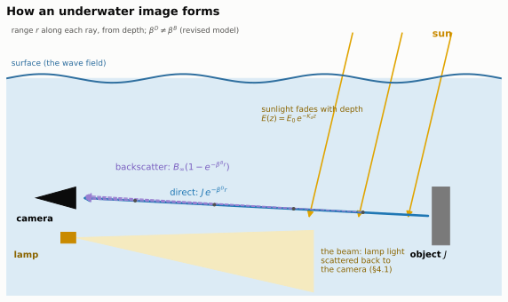

# gz_underwater_camera

A camera that sees through the world's water.

Gazebo renders a camera under water as if it were in air. This package turns
an RGBD camera's frames into what the camera sees through the water the
world describes ([`gz_water_optics`](../gz_water_optics/README.md)): far
things fade into a veil of the water's colour, red first; everything is lit
by daylight that has faded to its depth; and, if asked, the camera's
exposure, white balance and noise come on top.

It is the reference: the per-pixel model, on the CPU, exactly tested. A GPU
path for every camera and the GUI follows, and must match it.

## Use it

Put the plugin inside an `rgbd_camera` sensor, which renders colour and
depth in one pass, and give the sensor a `<topic>`:

```xml
<sensor name="camera" type="rgbd_camera">
  <topic>rov/camera</topic>
  <update_rate>15</update_rate>
  <camera>
    <horizontal_fov>1.2</horizontal_fov>
    <image><width>640</width><height>480</height></image>
    <clip><near>0.1</near><far>60</far></clip>
    <depth_camera><clip><near>0.1</near><far>60</far></clip></depth_camera>
  </camera>
  <plugin filename="gz-maritime-underwater-camera-system"
          name="gz::sim::maritime::UnderwaterCamera"/>
</sensor>
```

The world needs the water optics system for there to be any water; without
it the image is the plain camera's.

| Topic | Type | What |
|---|---|---|
| `<topic>/underwater/image` | `gz.msgs.Image`, RGB 8 bit | What the camera sees through the water |
| `<topic>/underwater/camera_info` | `gz.msgs.CameraInfo` | Its intrinsics, stamped like the image |
| `<topic>/image`, `<topic>/depth_image`, ... | as the `rgbd_camera` | Unchanged: the plain camera, and the depth a depth sensor sees |

## Parameters

| Element | Default | Meaning |
|---|---|---|
| `<output_topic>` | `<topic>/underwater` | Base of the output topics. |
| `<exposure>` | `1` | A gain on linear light, or `auto`: the mean luminance aimed at 0.18. |
| `<max_gain>` | `16` | With `auto`, the gain stays within 1/max and max. |
| `<white_balance>` | `none` | `none`, or `grey_world`: each channel's mean made the mean luminance, so the water's tint is taken out, as a camera's auto white balance does. |
| `<shot_noise>`, `<read_noise>` | `0` | Gaussian noise on linear light, of variance shot_noise · signal + read_noise². |
| `<seed>` | `1` | The noise's seed. |

## What it computes



For each pixel, from the in-air frame's colour J and z-depth:

1. **Range.** The z-depth along the camera's axis becomes the range r along
   the pixel's ray, from the camera's intrinsics (its `camera_info`).
2. **Linear light.** J is decoded from sRGB.
3. **The daylight that lit it.** The object is at depth z_o = z_cam − r ·
   (the ray's climb); its colour is faded by exp(−K_d z_o), the daylight
   left there.
4. **Through the water.** Only the water up to the surface counts, if the
   ray climbs out first: w = min(r, z_cam / climb). Then

   ```
   I = J exp(−K_d z_o) exp(−β^D w) + B∞(z_cam) (1 − exp(−β^B w))
   ```

   with B∞(z_cam) = B∞ exp(−K_d z_cam), the veil at the camera's depth, in
   units of a white surface lit by the surface daylight. A pixel that hits
   nothing sees the open water: the veil, or the sky through the surface.
5. **The camera.** Exposure, white balance, noise; back to sRGB.

With the camera above the water, the image is copied unchanged. Depth comes
from the world's water optics: below the wave field's local surface.

## Limits

- The water's surface between the camera and an object above it is treated
  as clear: Snell's window and the surface seen from below come later.
- The camera's pose is the one of the last simulation step, not of the
  frame's exact render.
- The sensor's own `<noise>` and `<distortion>` apply to its in-air image,
  before the water.
- No vehicle lights, forward scatter, marine snow or port refraction yet;
  see the [plan](../UNDERWATER_CAMERA_PLAN.md).

## Tests

```bash
colcon test --packages-select gz_underwater_camera
```

- `underwater_image_test`: the ray table against its formula; sRGB round
  trip for all 256 values; the model, every pixel against the closed form,
  at two ranges and with the object's depth; β^D ≠ β^B against the fog
  model; a climbing ray clipped at the surface; nothing hit is the veil; in
  air and in clear water the image unchanged; fixed and auto exposure; grey
  world neutralising a tint; the noise's mean and variance; 640×480 within a
  15 Hz frame; every parameter documented.
- `underwater_camera_test`, rendered (needs a GPU): the published image
  against the model computed in the test from the in-air frame, pixel by
  pixel; the far wall fading into the veil more than the near plate; above
  the water, byte for byte the plain image; the depth image untouched.
