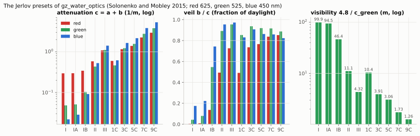

# gz_water_optics

What the world's water does to light.

A camera under water does not see what a camera in air sees: the water
between the lens and an object dims the object's light, red first; it adds a
veil of its own colour that grows with range; and the daylight that lights
the object has already faded on its way down. This package is where a world
says what its water is like, once, so every camera in it, and later every
sensor that looks through water, sees the same water.

It does not draw anything itself. The underwater camera (`gz_underwater_camera`,
next) and the GPU path read it.

## The water a world sets

`gz-maritime-water-optics-system` (`gz::sim::maritime::WaterOptics`) is a
world system:

```xml
<plugin filename="gz-maritime-water-optics-system"
        name="gz::sim::maritime::WaterOptics">
  <jerlov>3C</jerlov>              <!-- the kind of water -->
  <visibility>5</visibility>       <!-- optional: how far you can see, m -->
</plugin>
```

| Element | Meaning |
|---|---|
| `<jerlov>` | The Jerlov water type: `I`, `IA`, `IB`, `II`, `III` (open ocean, clearest first) or `1C`, `3C`, `5C`, `7C`, `9C` (coastal). Default `1C`. Case does not matter. Ignored, with a warning, when all four coefficients below are given. |
| `<visibility>` | How far a black target can be seen horizontally, m. It scales what the type has above pure water, up to about 100 m. Optional. |
| `<attenuation>`, `<backscatter>`, `<diffuse_attenuation>` | Per red, green, blue, 1/m, as `r g b`: each replaces the value the type gives. Optional. |
| `<veil>` | Per red, green, blue, the veil's colour just below the surface as a fraction of the daylight there. Optional. |
| `<water_level>` | World z of the still water, m. Default 0. Under a wave field, depth is measured below the local wave surface. |
| `<daylight>` | How strong the daylight is, against the renderer's sun: it scales the veil. Default 1; 0 at night, when only the vehicle's lamps light the water. |
| `<publish_rate>` | Rate of the ground truth, Hz of wall time, so it keeps coming while paused; it is also published on every change. 0 publishes on a change only. Default 1. |

Any other element is warned about. A water type nobody knows, a visibility
that is not positive or a negative coefficient is one error, and the world
has clear water until a good message comes on the set topic.

### What a water type means

Each type carries, per colour channel (red 625 nm, green 525 nm, blue
450 nm), its absorption a, its scattering b and the diffuse attenuation of
daylight K_d, from Solonenko and Mobley (2015), "Inherent optical properties
of Jerlov water types", *Applied Optics* 54(17). The system turns them into
the four numbers a camera needs:

| Quantity | From the type | Meaning |
|---|---|---|
| attenuation, β^D | c = a + b | How fast an object's light fades with range |
| backscatter, β^B | c = a + b | How fast the veil builds up with range |
| veil, B∞ | b / c | The veil's colour, as a fraction of the daylight |
| diffuse attenuation, K_d | K_d | How fast the daylight fades with depth |



### Visibility

People describe water as "5 m visibility". `<visibility>` uses the standard
relation of Zaneveld and Pegau (2003), visibility = 4.8 / c in the green: it
scales what a, b and K_d have above pure water's (type `I`), every channel
by the same factor. Clearer water turns bluer, as real water does, and none
is clearer than pure water: a visibility beyond about 100 m is an error, and
so is one for type `I` itself. With no `<jerlov>`, it scales type `1C`. An explicit `<attenuation>` wins over it, with a warning.

## Change it while running

Send a `gz.msgs.Param` to `/world/<world>/water_optics/set`. The keys are the
element names; a type and the per-channel values as strings, the numbers as
numbers:

```bash
gz topic -t /world/default/water_optics/set -m gz.msgs.Param \
  -p 'params {key: "jerlov" value {type: STRING string_value: "7C"}}'
gz topic -t /world/default/water_optics/set -m gz.msgs.Param \
  -p 'params {key: "visibility" value {type: DOUBLE double_value: 3}}'
```

An empty string removes a visibility or an explicit value. A message
applies whole or not at all: one bad key and nothing changes.

With `kai_bringup`'s simulation launch, the topic is bridged to ROS as a
`ros_gz_interfaces/msg/ParamVec`:

```bash
ros2 topic pub --once /world/default/water_optics/set \
  ros_gz_interfaces/msg/ParamVec \
  '{params: [{name: jerlov, value: {type: 4, string_value: "7C"}}]}'
```

## Ground truth

`/world/<world>/water_optics_info` (`gz.msgs.Param`): the water type, the
visibility, the four quantities above per channel, the water level and a
generation that goes up on every change.

```bash
gz topic -e -t /world/default/water_optics_info -n 1
ros2 topic echo --once /world/default/water_optics_info   # bridged, as a ParamVec
```

## For a system that sees through water

Keep a `gz::sim::water_optics::WaterOpticsSampler`, call `Sync` once per
step or frame, then ask:

| Call | Returns |
|---|---|
| `Depth(position, time)` | Depth below the local water surface, m (negative above it) |
| `Veil(depth)` | daylight · B∞ exp(−K_d depth): the veil there, zero above the surface and at night |
| `Data()` | The optics themselves: β^D, β^B, B∞ and K_d per channel |

A camera at depth z sees an object of colour J (as lit) at range r as

```
I = J · exp(−β^D r) + Veil(z) · (1 − exp(−β^B r))
```

`Depth` is the same in every process. Where the wave field's engine is not
there (the GUI and the sensors receive the wave recipe only), the sampler
builds one of its own from the recipe, as the water's visual does; it needs
the wave engine's plugin in that process, which the water surface model
loads.

A world without the system has clear water: nothing fades and there is no
veil.

## Tests

```bash
colcon test --packages-select gz_water_optics
```

- `water_optics_core_test`: the table's values pinned; every type present
  and in order; c, the veil and the visibility derived from a type, and one
  case by hand; visibility giving exactly the distance asked, scaling what
  the type has above pure water; explicit values overriding tag by tag, and
  all four ignoring the type; the errors; the sampler's closed forms, its
  copy on a new generation only, and depth below the wave from the recipe
  alone, as in the GUI; every parameter in the reference and among the set
  topic's keys.
- `water_optics_test`, in running worlds: the recipe written; the set topic
  and the ground truth; bad messages and messages that change nothing
  leaving the generation as it was, each checked with a marker sent after
  it; numbers as integers and strings; a reset; the ground truth while
  paused, and on a change only at a rate of 0; clear water without the
  system, and with a bad world file until a good message; depth below a
  Gerstner wave.
- `test_figures`: the plan's figures regenerated, byte for byte.

## Sources

- Solonenko, M. G. and Mobley, C. D. (2015). Inherent optical properties of
  Jerlov water types. *Applied Optics* 54(17), 5392–5401. The values are
  taken from the Apache-2.0 transcription of its tables in
  [tishibashi-cpu/jerlov](https://github.com/tishibashi-cpu/jerlov), which
  checks them against the paper's equations; 5C at 625 nm, whose printed
  row is corrupted, uses Williamson and Hollins (2022), *Applied Optics* 61,
  9951, and Jerlov, *Marine Optics* (1976). See `src/Jerlov.cc`.
- Zaneveld, J. R. V. and Pegau, W. S. (2003). Robust underwater visibility
  parameter. *Optics Express* 11(23), 2997–3009.
- Akkaynak, D. and Treibitz, T. (2018). A revised underwater image formation
  model. *CVPR*.
